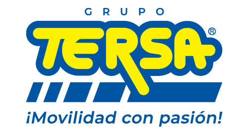
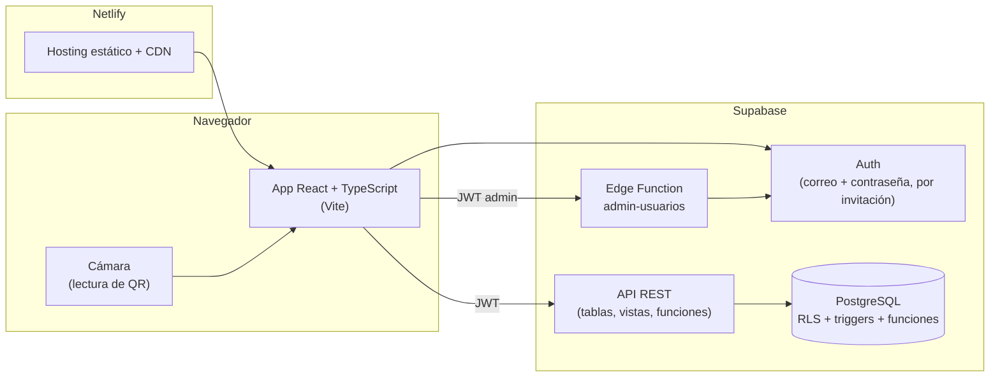

<p align="center">
  
</p>

<h1 align="center">Inventario de equipos de TI — Grupo Tersa</h1>

<p align="center">
  Sistema web que sustituye el inventario en Excel de los equipos de cómputo de Grupo Tersa:<br>
  sabe en todo momento <strong>dónde está cada equipo, en qué estado y quién lo tiene</strong>.
</p>

<p align="center">
  React 19 · TypeScript · Tailwind CSS 4 · Supabase (PostgreSQL, Auth, RLS) · Netlify
</p>

---

## Contenido

- [¿Qué problema resuelve?](#qué-problema-resuelve)
- [Funciones principales](#funciones-principales)
- [Roles](#roles)
- [Arquitectura](#arquitectura)
- [Estructura del repositorio](#estructura-del-repositorio)
- [Cómo ejecutarlo en local](#cómo-ejecutarlo-en-local)
- [Pruebas y calidad](#pruebas-y-calidad)
- [Despliegue](#despliegue)
- [Documentación](#documentación)
- [Estado del proyecto](#estado-del-proyecto)
- [Datos personales y seguridad](#datos-personales-y-seguridad)

## ¿Qué problema resuelve?

El área de Sistemas controlaba ~1,460 equipos (desktop, laptop, monitor y otros) en un Excel. Ahí no había
historial confiable, las cartas custodia se hacían a mano y alrededor de un tercio de los equipos figuraba como
«No localizado». Este sistema:

1. Es la **única fuente de verdad** del inventario, con historial auditable de cada cambio.
2. Genera las **cartas custodia y de devolución** (formato F.TI-006-02) y **etiquetas QR** listas para imprimir.
3. Permite hacer **inventario físico con el celular**: se escanea el QR y se abre la ficha del equipo.

## Funciones principales

| Módulo | Qué permite |
|---|---|
| **Panel** | Cifras clave, alertas (mantenimientos largos, apartados vencidos, contratos por vencer), distribución por empresa y avance de localización. Cada cifra abre el inventario ya filtrado. |
| **Inventario** | Alta, edición y cambio de estado de equipos; filtros por empresa, contrato, estado y tipo; exportación a CSV que Excel abre con acentos. |
| **Entregas y devoluciones** | Asistente de entrega a un colaborador (solo ofrece equipos entregables), devolución parcial o total, folios consecutivos `CC-AA-NNNN` / `CD-AA-NNNN`. |
| **Cartas y etiquetas** | Carta custodia, carta de devolución y hoja de etiquetas QR con vista previa fiel a lo que se imprime. |
| **Búsqueda y escaneo** | Búsqueda global por serie, colaborador o folio (sin importar acentos) y lectura de QR con la cámara. |
| **Historial** | Quién cambió qué y cuándo, para cada equipo y para todo el inventario. |
| **Colaboradores y catálogos** | Colaboradores con sus equipos; empresas, contratos, ubicaciones, unidades de negocio, subcategorías y marcas. |
| **Usuarios** | Invitación por correo, roles y desactivación de accesos (solo Administrador). |

El detalle de cada pantalla está en el [manual de usuario](docs/05-manual-de-usuario.md).

## Roles

| Rol | Puede |
|---|---|
| **Administrador** (Sistemas) | Todo: registrar equipos, entregas y devoluciones, imprimir documentos y administrar usuarios. |
| **Lector** (Contabilidad, Dirección) | Consultar inventario, panel e historial y exportar a CSV. No puede hacer cambios. |

Los permisos se aplican **en la base de datos** (Row Level Security), no solo ocultando botones: un Lector no
puede escribir aunque llame directamente a la API.

## Arquitectura



**Principio rector:** las reglas de negocio viven en PostgreSQL (restricciones, triggers, funciones y RLS). La
interfaz las refleja para guiar al usuario, pero la base de datos es la que las garantiza; por ejemplo, un
equipo no puede entregarse dos veces aunque dos personas lo intenten al mismo tiempo.

| Capa | Tecnología |
|---|---|
| Interfaz | React 19, TypeScript, Vite, Tailwind CSS 4, Radix UI, lucide-react |
| Rutas y datos | React Router, TanStack Query, `@supabase/supabase-js` |
| Formularios | react-hook-form + zod |
| QR | `qrcode` (generar) · `BarcodeDetector` / `@zxing/browser` (leer) |
| Backend | Supabase: PostgreSQL, Auth, Edge Functions (Deno) |
| Pruebas | Vitest + Testing Library · Playwright + axe (e2e y accesibilidad) · pruebas SQL |
| Hosting | Netlify |

## Estructura del repositorio

```text
├─ docs/                          Diseño, plan, migración, UI/UX y manual de usuario
├─ src/
│  ├─ app/                        Router, layout principal y menú
│  ├─ components/ui/              Componentes reutilizables (tabla, diálogos, campos, filtros…)
│  ├─ features/                   Un módulo por área: panel, equipos, asignaciones, documentos,
│  │                              busqueda, historial, colaboradores, catalogos, usuarios, auth
│  ├─ lib/                        Cliente Supabase, formatos, QR, utilidades
│  └─ types/database.ts           Tipos generados desde el esquema de la BD
├─ supabase/
│  ├─ migrations/                 Esquema versionado (tablas, RLS, funciones)
│  ├─ functions/admin-usuarios/   Edge Function para invitar y administrar usuarios
│  ├─ tests/                      Pruebas SQL de las reglas de negocio
│  └─ templates/                  Plantilla del correo de invitación
├─ scripts/migracion/             Extracción y conciliación del Excel original (Python)
├─ e2e/                           Pruebas de punta a punta (Playwright)
└─ public/                        Favicon y reglas de rutas de Netlify
```

## Cómo ejecutarlo en local

**Requisitos:** Node.js 24 y npm 11. Opcional: [Supabase CLI](https://supabase.com/docs/guides/local-development)
2.x para aplicar migraciones, y Python 3.12+ solo para los scripts de migración del Excel.

```bash
git clone https://github.com/ErikAboytes/inventario-ti-tersa.git
```

```bash
cd inventario-ti-tersa
```

```bash
npm install
```

```bash
cp .env.example .env.local
```

En `.env.local` llena `VITE_SUPABASE_PUBLISHABLE_KEY` con la clave **pública** (`sb_publishable_…`) del
proyecto Supabase. La clave `service_role` nunca va en el frontend.

```bash
npm run dev
```

La app abre en `http://localhost:5173`. Para entrar se necesita una cuenta invitada por un Administrador.

### Usar un proyecto Supabase propio

Para levantar la base de datos desde cero en otro proyecto:

```bash
supabase link --project-ref <ref-del-proyecto>
```

```bash
supabase db push
```

```bash
supabase functions deploy admin-usuarios
```

Después se ajustan en `.env.local` la URL y la clave pública de ese proyecto. En el panel de Supabase se
configuran las URL permitidas de Auth y la plantilla del correo de invitación (`supabase/templates/invitacion.html`).

### Scripts

| Script | Qué hace |
|---|---|
| `npm run dev` | Servidor de desarrollo |
| `npm run build` | Revisa tipos y genera `dist/` |
| `npm run preview` | Sirve localmente el resultado de `build` |
| `npm test` | Pruebas unitarias y de pantallas (Vitest) |
| `npm run e2e` | Pruebas de punta a punta (Playwright; ver [e2e/README.md](e2e/README.md)) |
| `npm run lint` | Análisis estático (oxlint) |
| `npm run format` | Formatea `src/` con Prettier |
| `npm run check` | Formato + lint + tipos + pruebas: lo que debe pasar antes de abrir un PR |
| `npm run tipos` | Regenera `src/types/database.ts` desde el proyecto Supabase enlazado |

## Pruebas y calidad

- **Reglas de negocio en SQL** (`supabase/tests/`): entregar un equipo no entregable falla, un Lector no puede
  escribir, los folios son consecutivos sin huecos, etc.
- **Frontend** (`*.test.ts(x)`): lógica de formatos, CSV, QR, validaciones y pantallas clave con Testing Library.
- **E2E** (`e2e/`): login por rol, flujo completo de entrega → carta → etiquetas → devolución, búsqueda, CSV,
  navegación en celular y revisión automática de accesibilidad (WCAG 2.2 AA) con axe.

## Despliegue

Netlify compila con `npm run build` y publica `dist/` (ver [netlify.toml](netlify.toml)). Cada PR genera una
vista previa. Las rutas de la app se resuelven con `public/_redirects`, así que recargar cualquier página funciona.

Variables en Netlify: `VITE_SUPABASE_URL`, `VITE_SUPABASE_PUBLISHABLE_KEY` y, opcionalmente, `VITE_URL_PUBLICA`
(el dominio que se imprime en los QR).

## Documentación

| Documento | Contenido |
|---|---|
| [01 — Diseño del sistema](docs/01-diseno-del-sistema.md) | Arquitectura, modelo de datos, reglas de negocio, seguridad |
| [02 — Plan de desarrollo](docs/02-plan-de-desarrollo.md) | Etapas, criterios de aceptación y forma de trabajo |
| [03 — Análisis y migración del Excel](docs/03-analisis-y-migracion-de-datos.md) | Calidad de los datos originales y cómo se migraron |
| [04 — Diseño UI/UX](docs/04-diseno-ui-ux.md) | Pantallas, flujos, identidad visual y accesibilidad |
| [05 — Manual de usuario](docs/05-manual-de-usuario.md) | Cómo usar el sistema día a día |
| [PRODUCT.md](PRODUCT.md) | Resumen del producto: usuarios, propósito y principios |

## Estado del proyecto

Las etapas 0 a 9 del [plan](docs/02-plan-de-desarrollo.md) están terminadas y el sistema funciona en el
entorno de desarrollo con los datos migrados del Excel. Falta la **Etapa 10 — Salida a producción**, que se
planea tras la aprobación de Grupo Tersa: cuentas propias de la empresa, proyecto Supabase de producción, SMTP
y dominio, resolución de las incidencias de la migración y capacitación.

## Datos personales y seguridad

- Los Excel fuente y cualquier archivo derivado **no se versionan** (`.gitignore`): contienen datos personales.
- No hay claves en el repositorio; solo `.env.example` con la URL del proyecto de desarrollo.
- Los datos de colaboradores se limitan a lo necesario (LFPDPPP).

## Forma de trabajo

- `main` solo recibe cambios por **pull request**; cada cambio va en su propia rama y el merge lo aprueba el
  responsable del proyecto.
- El esquema de la base de datos cambia solo con migraciones nuevas en `supabase/migrations/`.
- En `.claude/skills/` están las guías de diseño (Impeccable, UI UX Pro Max, motion-design) que se usaron para
  revisar la interfaz con Claude Code; no forman parte de la app (ver `ORIGEN.txt` de cada una).
