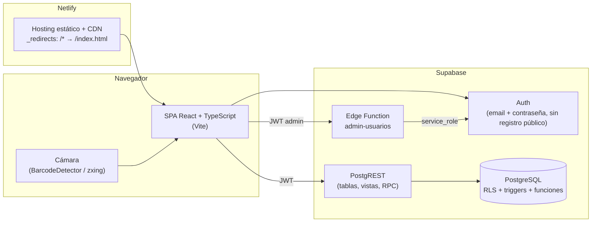
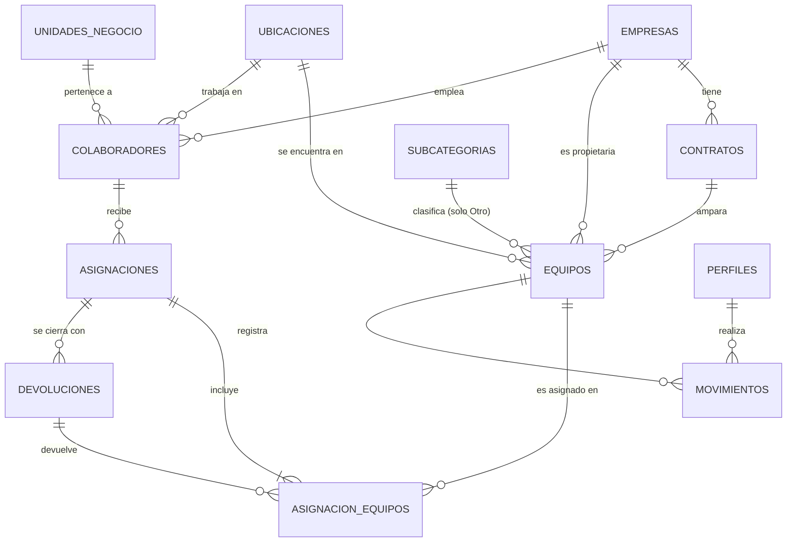
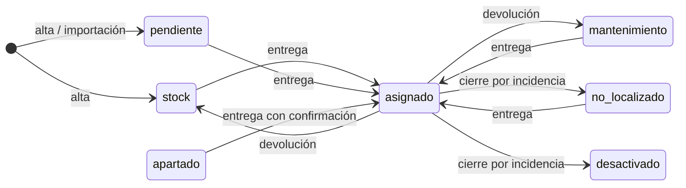

# Diseño del sistema — Inventario de equipos de cómputo Tersa

> Estado: **borrador v0.2** (2026-10-19). Decisiones D1–D9 resueltas (ver [§12](#12-decisiones)).

Documentos relacionados:
- [02 — Plan de desarrollo por etapas](02-plan-de-desarrollo.md)
- [03 — Análisis del Excel y plan de migración](03-analisis-y-migracion-de-datos.md)
- [04 — Diseño de la interfaz (UI/UX)](04-diseno-ui-ux.md): pantallas, navegación, flujos, componentes y rutas

---

## 1. Objetivo y alcance

Sustituir el inventario en Excel por una aplicación web que controle el ciclo de vida de los equipos de
cómputo (desktop, laptop, monitor y otro): alta, estado, ubicación, asignación a colaboradores,
devolución, cartas custodia, etiquetas QR e historial auditable, con acceso por roles.

Fuera de alcance de la primera versión: control financiero de contratos (mensualidades, facturas),
infraestructura de red y servidores (servidores, switches, storage, UPS), mesa de ayuda/tickets,
inventario de software y licencias, integración con LogMeIn.

## 2. Arquitectura



**Principio rector:** las reglas de negocio viven en la base de datos (constraints, triggers, funciones RPC y
RLS). El frontend las refleja para dar buena experiencia, pero no es la única barrera. Así, un Lector no
puede escribir aunque llame directo a la API, y un equipo no puede asignarse dos veces aunque dos personas
lo intenten al mismo tiempo.

### 2.1 Stack

| Capa | Elección | Motivo |
|---|---|---|
| Build | Vite + React + TypeScript | Estándar actual, rápido, tipado de extremo a extremo |
| Ruteo | React Router (`BrowserRouter`) | URLs limpias y recargables; filtros en query string |
| Datos | `@supabase/supabase-js` + TanStack Query | Caché, reintentos, invalidación tras mutaciones |
| Formularios | react-hook-form + zod | Validación declarativa compartida entre alta y edición |
| UI | Tailwind CSS + primitivas Radix UI (estilo shadcn/ui) | Diálogos accesibles (Escape, foco atrapado, `aria-modal`) sin reinventar |
| QR | `qrcode` (generar) · `BarcodeDetector` nativo con respaldo `@zxing/browser` (leer) | El escaneo funciona donde el navegador lo permita; si no, búsqueda manual |
| CSV | `papaparse` | Exportación con BOM UTF-8 para que Excel respete acentos |
| Impresión | Vistas HTML con CSS `@media print` + `window.print()` | Cartas y etiquetas se imprimen o guardan como PDF desde el navegador |
| Tipos BD | `supabase gen types typescript` | El esquema SQL es la fuente de verdad de los tipos |
| Pruebas | Vitest + Testing Library · Playwright (e2e) · scripts SQL para reglas | |
| Migraciones | Supabase CLI (`supabase/migrations/*.sql`) | Esquema versionado en el repositorio |

Las versiones exactas se fijan en la Etapa 0 con las estables vigentes en ese momento.

### 2.2 Entornos

| Entorno | Frontend | Backend |
|---|---|---|
| Desarrollo local | `npm run dev` | Supabase **«Tersa»** (dev) |
| Previsualización | Netlify deploy previews (por rama/PR) | Supabase **«Tersa»** (dev) |
| Producción | Netlify rama `main` | Proyecto Supabase **prod**, por definir (Etapa 9) |

Proyecto dev **«Tersa»**: ref `xjjadzzjhbiezvjjgsst`, región `us-west-2`, organización «ErikAboytes's Org»
(decisión del usuario, 2026-10-19). El otro proyecto de la organización, «InventariOS - Stagin», está pausado
y no se usa.

> Estado al 2026-10-19 (verificado): **0 migraciones y 0 tablas**. La migración previa `20261018100050
> extensiones_tipos`, de otro diseño, se descartó ese día a petición del usuario (se borraron sus enums y
> `pg_trgm`). Las migraciones de la Etapa 1 empiezan desde cero y crean sus propias extensiones.
> Por decisión del usuario (2026-10-19) **se conservan** el usuario de Auth `test@test.com` (no se borra sin
> preguntar) y el event trigger `ensure_rls`, que activa RLS automáticamente en las tablas nuevas de `public`.

Variables de entorno del frontend: `VITE_SUPABASE_URL` y `VITE_SUPABASE_PUBLISHABLE_KEY` (clave pública `sb_publishable_…`).
La clave `service_role` **nunca** llega al frontend; solo la usa la Edge Function.

Netlify sirve `index.html` para cualquier ruta (`public/_redirects`: `/*  /index.html  200`), por lo que
recargar o abrir un enlace directo funciona en todas las rutas de la app (detalle en el doc 04).

> Riesgo operativo: los proyectos del plan gratuito de Supabase se pausan tras días sin actividad y no
> incluyen respaldos diarios. Para producción conviene el plan Pro o, como mínimo, un respaldo programado
> (`pg_dump`) y monitoreo de actividad.

## 3. Modelo de dominio



### 3.1 Tipos enumerados

| Enum | Valores |
|---|---|
| `categoria_equipo` | `desktop`, `laptop`, `monitor`, `otro` |
| `estado_equipo` | `stock`, `asignado`, `mantenimiento`, `apartado`, `desactivado`, `no_localizado`, `pendiente` |
| `rol_usuario` | `admin`, `lector` |
| `tipo_movimiento` | `alta`, `edicion`, `cambio_estado`, `asignacion`, `devolucion`, `cierre_incidencia`, `importacion` |
| `destino_devolucion` | `stock`, `mantenimiento`, `no_localizado`, `desactivado` (los dos últimos solo para cierre por incidencia) |
| `condicion_equipo` | `buen_estado`, `con_detalles`, `danado` (estado físico del equipo) |

### 3.2 Tablas

**`empresas`** — razones sociales propietarias de equipos y empleadoras de colaboradores.
`id`, `clave` (único: TRO, TAU, CRVH, REVOR, ROVAL…), `razon_social` (inicialmente igual a la clave, D3),
`rfc` (opcional), `activa`.

**`contratos`** — operaciones de arrendamiento/compra (hoja CONTRATOS del Excel).
`id`, `operacion` (único: `TERSA001`, `PEUGEOT006`…; es lo que la carta muestra como «Contrato»),
`numero_contrato`, `empresa_id`, `descripcion`, `fecha_vencimiento`, `estatus` (`vigente`, `comprado`,
`pagado`, `vencido`), `notas`.

**`ubicaciones`** — catálogo normalizado (sucursales, corporativo, almacén de Sistemas, externos).
`id`, `nombre` (único, p. ej. «Tersa Tecate»), `tipo` (`sucursal`, `corporativo`, `almacen`, `externo`),
`ciudad`, `estado_republica`, `activa`.

**`unidades_negocio`** — catálogo para el campo «Unidad de Negocios» de la carta (Llantas, Renault…).
`id`, `nombre` (único), `activa`.

**`subcategorias`** — solo para equipos de categoría Otro (iPad/Tablet…).
`id`, `nombre` (único), `activa`.

**`colaboradores`**
`id`, `numero_empleado` (único, opcional), `nombre_completo`, `puesto`, `unidad_negocio_id`, `area`,
`empresa_id`, `ubicacion_id`, `email`, `tipo` (`persona` | `generico`), `activo`.

**`equipos`** — el activo.

| Columna | Tipo | Regla |
|---|---|---|
| `id` | uuid PK | Identificador que va en el QR; nunca cambia |
| `categoria` | `categoria_equipo` | obligatorio |
| `subcategoria_id` | FK | obligatorio si `categoria = 'otro'`, nulo en otro caso (CHECK) |
| `serie` | text | obligatorio, único sin distinguir mayúsculas ni espacios (`unique (upper(trim(serie)))`). Si el equipo no tiene serie visible, el sistema asigna un identificador interno `SINSERIE-0001`… |
| `numero_producto` | text | opcional (p. ej. `W6B92LT#ABM`); aparece en la carta |
| `marca`, `modelo` | text | obligatorios |
| `descripcion` | text | texto original/especificaciones |
| `empresa_id` | FK | opcional solo para equipos fuera de contrato; si hay contrato, se toma de él y deben coincidir |
| `contrato_id` | FK | opcional (hay equipos fuera de contrato) |
| `ubicacion_id`, `ubicacion_detalle` | FK, text | detalle = caja/mueble/cajón dentro del almacén |
| `estado` | `estado_equipo` | ver §4 |
| `apartado_para` | text | obligatorio si `estado = 'apartado'` (CHECK) |
| `motivo_desactivacion` | text | obligatorio si `estado = 'desactivado'` (CHECK) |
| `condicion` | `condicion_equipo` | estado físico; **nulo = «Sin revisar»** (p. ej. equipos importados sin ese dato) |
| `observaciones_estado` | text | detalle del estado físico («Ligero golpe en chasis y leves rayones en la pantalla. Sigue en estado funcional.»); **obligatorio si la condición es `con_detalles` o `danado`** (CHECK) |
| `cpu`, `gpu`, `almacenamiento`, `sistema_operativo` | text | especificaciones, opcionales; **solo Desktop y Laptop** (CHECK: nulas en otras categorías) |
| `ram_gb` | smallint | memoria RAM en GB (1–4096), opcional; solo Desktop y Laptop |
| `notas` | text | |
| `creado_en/por`, `actualizado_en/por` | | llenados por trigger |

**`asignaciones`** — una entrega (uno o varios equipos) y su carta custodia.

| Columna | Regla |
|---|---|
| `id` (uuid), `folio` | folio único `CC-26-0001` (§4.4); las importadas conservan `SIS0xxx` |
| `colaborador_id`, `fecha_entrega`, `entregado_por` | `entregado_por` = perfil del Administrador que registra |
| `lugar_expedicion` | p. ej. «Tijuana BC»; editable, con valor por defecto |
| `datos_colaborador` (jsonb) | **instantánea** de nombre, puesto, unidad de negocio y ubicación al momento de la entrega: la carta reimpresa sale igual aunque el colaborador cambie después |
| `firma_entrega_nombre`, `firma_entrega_puesto` | por defecto el usuario en sesión; **editables** |
| `firma_recibe_nombre`, `firma_recibe_puesto` | por defecto el colaborador; **editables** (quien firma no siempre es el colaborador) |
| `observaciones`, `es_historica`, `cerrada_en` | |

**`asignacion_equipos`** — renglones de la asignación.
`id`, `asignacion_id`, `equipo_id`, `devolucion_id` (nulo mientras está activo), `destino_devolucion`,
`condicion_devolucion` (`condicion_equipo`), `observaciones_devolucion` (obligatorias si la condición es
`con_detalles` o `danado`).
Índice único parcial `(equipo_id) where devolucion_id is null` ⇒ **un equipo no puede tener dos
asignaciones activas**, ni siquiera ante peticiones simultáneas.

**`devoluciones`** — recepción de uno o varios equipos de una asignación (parcial o total).
`id`, `folio` (`CD-26-0001`), `asignacion_id`, `fecha`, `lugar_expedicion`, `recibido_por`,
`firma_entrega_nombre/puesto` (por defecto el colaborador), `firma_recibe_nombre/puesto` (por defecto el
usuario en sesión), `observaciones`, `es_cierre_incidencia` (extravío/baja; no genera carta).

**`folios_control`** — contador sin huecos por tipo y año.
`tipo` (`CC`, `CD`), `anio`, `ultimo`; PK (`tipo`, `anio`). Se incrementa con `UPDATE … RETURNING` dentro de
la misma transacción de la entrega/devolución (una secuencia de Postgres dejaría huecos al revertir).

**`movimientos`** — historial auditable; **solo inserción** (sin UPDATE/DELETE para nadie).
`id`, `equipo_id`, `tipo`, `estado_anterior`, `estado_nuevo`, `cambios` (jsonb `{campo: [antes, después]}`),
`asignacion_id`, `devolucion_id`, `nota`, `usuario_id`, `creado_en`.
Lo llena un trigger `AFTER INSERT OR UPDATE` en `equipos`; las funciones RPC indican el contexto
(asignación, devolución, importación) con `set_config('app.contexto', …, true)` para clasificar el movimiento.

**`perfiles`** — extensión de `auth.users`.
`id` (= `auth.users.id`), `nombre`, `puesto` (para la firma «Entrega»), `email`, `rol`, `activo`, `creado_en`.

### 3.3 Vistas y funciones

| Objeto | Uso |
|---|---|
| `v_equipos` (`security_invoker`) | Lista/ficha/exportación: equipo + empresa + contrato + ubicación + asignación activa + colaborador |
| `v_asignaciones` | Historial de asignaciones con conteo de equipos activos/devueltos |
| `metricas_panel()` | Conteos por estado, categoría y empresa; contratos por vencer; movimientos recientes |
| `crear_asignacion(colaborador, equipos[], fecha, firmas, lugar, observaciones)` | Transacción atómica; ver §4.2 |
| `registrar_devolucion(asignacion, items[{equipo, destino, condicion, observaciones}], fecha, firmas, observaciones)` | Transacción atómica; ver §4.3 |
| `actualizar_firmas(asignacion \| devolucion, firmas, lugar)` | Corrige los datos de firma antes de reimprimir (queda en historial) |
| `cambiar_estado(equipo, estado, apartado_para, motivo, nota)` | Cambios manuales permitidos (§4.1) |
| `buscar_global(texto)` | QR/URL, UUID, serie, colaborador, folio (insensible a acentos con `unaccent` + `pg_trgm`) |
| `siguiente_folio(tipo)` | Uso interno de las RPC: `CC-26-0001`, `CD-26-0001` |
| `privado.es_admin()`, `privado.es_usuario_activo()` | Helpers `security definer` usados por las políticas RLS; en un esquema que la API no expone |

Extensiones: `pgcrypto` (uuid), `pg_trgm` (búsqueda parcial), `unaccent` (Chávez = Chavez).

## 4. Reglas de negocio

### 4.1 Estados y transiciones



- **Asignables:** `stock`, `mantenimiento`, `no_localizado`, `pendiente`, y `apartado` **con confirmación**:
  el asistente muestra la etiqueta («Apartado para: Rossy Insunza») y pide confirmar que se entrega a esa
  persona o destino (D1). **No asignables:** `asignado`, `desactivado`.
- **`asignado` solo se entra y se sale por los flujos de entrega/devolución.** Un trigger rechaza cualquier
  `UPDATE` que ponga o quite `asignado` fuera de esas funciones. El formulario de edición no ofrece ese estado.
- Entre los demás estados (`stock`, `mantenimiento`, `apartado`, `desactivado`, `no_localizado`, `pendiente`)
  el Administrador puede cambiar manualmente con `cambiar_estado`, que exige:
  - `apartado` → etiqueta **para quién / para qué** (`apartado_para`);
  - `desactivado` → **motivo** (venta, venta a CGE, donativo, daño irreparable, fin de contrato…);
  - al salir de `apartado`/`desactivado` se limpian esos campos (queda el valor anterior en el historial).
- Los equipos **nunca se borran**: la baja es el estado `desactivado`. Así el historial y los folios siguen íntegros.

### 4.2 Entrega (asignación)

1. Admin elige colaborador activo y uno o más equipos (el buscador solo muestra asignables).
2. Revisa los **datos de firma** (Entrega/Recibe: nombre y puesto) y el lugar; vienen prellenados y se pueden
   editar a mano.
3. `crear_asignacion` bloquea los equipos (`SELECT … FOR UPDATE`), valida que todos sean asignables,
   genera el folio, crea la asignación (con la instantánea del colaborador) y sus renglones, pasa los equipos
   a `asignado`, actualiza su ubicación a la del colaborador y registra un movimiento por equipo. Si un
   equipo falla, no se guarda nada.
4. Al terminar se abre **«Documentos de la asignación»**: la carta custodia **y** la hoja de etiquetas QR de
   los equipos entregados, para imprimir juntas o por separado.

### 4.3 Devolución

1. Desde la asignación activa se marcan los equipos que regresan (parcial o total) y su destino:
   `stock` o `mantenimiento`, con condición/observaciones.
2. `registrar_devolucion` crea la devolución con folio, cierra los renglones, cambia el estado de los equipos
   (ubicación por defecto: almacén de Sistemas) y registra movimientos. Si ya no quedan renglones activos,
   marca la asignación como cerrada.
   La condición y observaciones de cada renglón **actualizan el estado físico del equipo** (`condicion`,
   `observaciones_estado`); si un renglón no trae condición, el equipo conserva la que tenía. El cambio queda
   en el historial como «Estado físico: antes → después».
3. La **carta de devolución** no se genera automáticamente: hay un botón «Generar carta de devolución» en
   la devolución para cuando se requiera; antes de imprimir se pueden editar los datos de firma.
4. **Cierre por incidencia** (extravío o baja de un equipo que estaba asignado): mismo flujo con destino
   `no_localizado` o `desactivado` y motivo obligatorio; no genera carta.

### 4.4 Folios

Nuevo formato **`TT-AA-NNNN`**: tipo de documento, año de dos dígitos y consecutivo de 4 dígitos que reinicia
cada año.

| Documento | Ejemplo | Por qué |
|---|---|---|
| Carta custodia (asignación) | `CC-26-0001` | Se reconoce el tipo y el año a simple vista; ordena bien; 9,999 por año (hoy se emiten unas cuantas centenas) |
| Carta de devolución | `CD-26-0001` | Misma lógica; no se confunde con la custodia |

- Se generan dentro de la transacción con `folios_control` ⇒ consecutivos **sin huecos** y sin duplicados.
- Las asignaciones importadas del Excel conservan su folio `SIS0001`–`SIS0755`; las que no tenían carta
  quedan como `HIST-0001`… Las tres familias conviven y la búsqueda por folio encuentra cualquiera.

## 5. Seguridad y control de acceso

| Acción | Administrador | Lector |
|---|---|---|
| Consultar inventario, fichas, historial, panel, cartas, buscar/escanear | ✔ | ✔ |
| Exportar CSV, imprimir cartas y etiquetas | ✔ | ✔ |
| Alta/edición de equipos y cambios de estado | ✔ | ✘ |
| Entregas, devoluciones y edición de datos de firma | ✔ | ✘ |
| Colaboradores y catálogos | ✔ | ✘ |
| Administrar usuarios y roles | ✔ | ✘ |

- **Auth:** email + contraseña con Supabase Auth; **registro público deshabilitado**. Los usuarios los invita
  un Administrador (Edge Function `admin-usuarios`, que verifica el rol del solicitante y usa `service_role`).
  El primer Administrador se crea manualmente en la Etapa 1.
- **RLS activado en todas las tablas**, de forma explícita en cada migración. El event trigger `ensure_rls`
  del proyecto queda como red de seguridad para cualquier tabla nueva. `SELECT` para `es_usuario_activo()`; `INSERT/UPDATE/DELETE` solo para
  `es_admin()`; `movimientos` sin `UPDATE/DELETE` para nadie. Un perfil desactivado pierde acceso aunque su
  sesión siga abierta.
- Protección contra quedarse sin Administradores: no se puede degradar ni desactivar al último.
- **QR:** apunta a la ficha del equipo dentro de la app y **requiere sesión**, porque muestra datos personales
  del colaborador (D5). Quien escanea sin sesión ve el login y, al entrar, llega a la ficha.
- **Datos personales** (LFPDPPP): solo nombre, puesto, unidad de negocio, área, ubicación y correo laboral.
- **Credenciales en el Excel:** la columna LogMeIn contiene usuarios y contraseñas en texto plano. **No se
  migra** al sistema; se recomienda cambiar esas contraseñas (ver documento 03).
- Revisión de los *advisors* de seguridad y rendimiento de Supabase antes de cada salida a producción.

## 6. Módulos funcionales

| Módulo | Contenido |
|---|---|
| **Panel operativo** | Total de equipos activos; conteo por estado, categoría y empresa; contratos por vencer (90 días); movimientos recientes. Todo calculado por `metricas_panel()` |
| **Inventario** | Lista con búsqueda, filtros (categoría, subcategoría, estado, empresa, contrato, ubicación), orden (incl. por empresa), agrupación por empresa, paginación del lado servidor, selección múltiple para etiquetas, exportación CSV del resultado filtrado completo |
| **Ficha de equipo** | Datos, estado con etiqueta (apartado para / motivo de baja), asignación activa con colaborador y folio, historial de movimientos, QR, acciones según rol |
| **Alta / edición** | Formulario con validación; subcategoría solo para Otro; empresa propuesta desde el contrato; serie única |
| **Entregas** | Asistente: colaborador → equipos asignables → datos de firma → confirmar → documentos (carta + etiquetas) |
| **Devoluciones** | Desde la asignación: equipos que regresan, destino, condición; carta opcional |
| **Historial** | Movimientos filtrables (equipo, colaborador, tipo, fechas, usuario) con detalle «campo: antes → después»; historial de asignaciones con vista imprimible |
| **Búsqueda / QR** | Caja única para QR, UUID, serie, colaborador o folio; botón de cámara si el navegador lo soporta y concede permiso |
| **Cartas y etiquetas** | Carta custodia (formato F.TI-006-02), carta de devolución, etiquetas QR por asignación o por lote |
| **Colaboradores** | Alta/edición/baja lógica; equipos asignados actualmente e historial |
| **Catálogos** | Empresas, contratos, ubicaciones, unidades de negocio, subcategorías de Otro |
| **Usuarios** | Invitar, cambiar rol, desactivar |

Pantallas, rutas, navegación y flujos de interfaz: ver **[04 — Diseño UI/UX](04-diseno-ui-ux.md)**.

## 7. Documentos imprimibles y QR

### 7.1 Carta custodia (réplica del formato F.TI-006-02)

Tamaño carta, generada en HTML para imprimir o guardar como PDF. Estructura tomada de la carta actual
(folio SIS0750 de ejemplo):

1. Logotipo de Grupo Tersa (arriba izquierda) y recuadro **Folio** (arriba derecha).
2. Título «Carta Custodia / Equipo de Cómputo»; línea «**Tijuana BC, a 09 de 07 del 2026**» (lugar editable + fecha).
3. **Datos del Equipo:** Marca / Modelo · Número de serie · Número de producto · Contrato (operación).
   - 1 equipo: mismo formato vertical de la carta actual.
   - 2 o más equipos: tabla con un renglón por equipo y las mismas cuatro columnas.
   - El estado físico (condición y observaciones) **no se imprime**; solo se consulta en el sistema.
4. **Datos del Usuario:** Nombre · Puesto · Unidad de Negocios · Ubicación (de la instantánea de la asignación).
5. Texto de compromiso y las **6 cláusulas** de la carta actual + «Manifiesto haber leído…». El texto queda
   versionado en el código junto con el código de formato `F.TI-006-02`; si cambia, se sube la revisión del formato.
6. Firmas **Entrega** y **Recibe** con nombre y puesto **editables a mano** (prellenados con el usuario en
   sesión y el colaborador).
7. Pie con el código de formato `F.TI-006-02`.

El título de la página de impresión se arma como
`F.TI-006-02 Carta Custodia CC-26-0001 5CD626170N Jose Carlos Lopez`, de modo que **«Guardar como PDF» propone
el mismo nombre de archivo que usan hoy** (con varios equipos se usa la serie del primero y «+N»).

La carta usa el logotipo de **Grupo Tersa** en lugar del de Tersa Corp. del formato anterior (decisión del
usuario, 2026-10-19), igual que la interfaz (doc 04 §7). Como cambia un formato controlado, conviene subir
su revisión (p. ej. `F.TI-006-03`). Hay que confirmarlo con quien administre los formatos; mientras tanto el
código del formato es configurable.

### 7.2 Carta de devolución (bajo demanda)

Mismo lenguaje visual: folio `CD-…`, folio de la carta custodia original, equipos devueltos con destino y
condición, texto de recepción y firmas Entrega (colaborador) / Recibe (Sistemas), ambas editables.
Como no existe un formato oficial, se propone el diseño y se valida en la Etapa 6.

### 7.3 Vista imprimible de la asignación

Resumen operativo (folio, colaborador, equipos, fechas de entrega y devolución de cada renglón, movimientos).
No lleva texto legal ni firmas.

### 7.4 Etiquetas QR

- Se imprimen en **hoja carta normal** con guías de corte: rejilla de 3 × 8 etiquetas (≈ 6.5 × 3.2 cm),
  QR de al menos 2.5 cm para que lo lea cualquier celular.
- Contenido: QR + serie + marca/modelo + categoría + operación + clave de empresa.
- Se generan **automáticamente junto con la carta custodia** al completar una asignación (una por equipo
  entregado) y también por lote desde la selección del inventario.
- El QR codifica `https://<dominio>/e/<uuid>`, que abre la ficha con la asignación activa al frente.

### 7.5 Búsqueda por QR

El buscador acepta la URL completa del QR, el UUID solo, la serie, el nombre del colaborador o cualquier folio
(`CC-…`, `CD-…`, `SIS…`, `HIST-…`). El escaneo con cámara usa `BarcodeDetector` cuando existe y
`@zxing/browser` como respaldo; si no hay soporte o se niega el permiso, se muestra un mensaje claro y queda
la búsqueda por texto.

## 8. Interfaz

La arquitectura funcional de la interfaz (mapa de navegación, pantallas, flujos, componentes, diseño
adaptable, accesibilidad y rutas) está en **[04 — Diseño UI/UX](04-diseno-ui-ux.md)**.

## 9. Estructura del repositorio

```text
/
├─ docs/                         diseño, plan, migración, UI/UX, manual
├─ supabase/
│  ├─ migrations/                SQL versionado (esquema, RLS, funciones)
│  ├─ functions/admin-usuarios/  Edge Function de invitación y roles
│  ├─ tests/                     pruebas SQL de reglas de negocio
│  └─ seed.sql                   datos de ejemplo para desarrollo
├─ scripts/migracion/            extracción y normalización del Excel
├─ public/_redirects
├─ src/
│  ├─ app/                       router, proveedores, layout, guardas por rol
│  ├─ components/ui/             botones, diálogos, tabla, formularios, badges
│  ├─ features/
│  │  ├─ auth/  panel/  equipos/  asignaciones/  devoluciones/
│  │  ├─ historial/  busqueda/  documentos/ (cartas y etiquetas)
│  │  └─ colaboradores/  catalogos/  usuarios/
│  ├─ lib/                       cliente supabase, csv, qr, formatos de fecha
│  └─ types/database.ts          generado desde el esquema
├─ netlify.toml
└─ package.json
```

## 10. Calidad

- **Reglas de negocio en SQL** con pruebas: asignar equipo no asignable falla; doble asignación concurrente
  falla; Lector no puede escribir; apartado sin etiqueta y desactivado sin motivo fallan; `asignado` no se
  puede poner por edición directa; folios consecutivos sin huecos ni duplicados.
- **Frontend:** pruebas unitarias de utilidades (CSV, parseo de QR, formato de folio y fecha de la carta) y
  componentes clave.
- **E2E (Playwright)** sobre deploy preview: login por rol, alta de equipo, entrega + carta + etiquetas,
  devolución, búsqueda por serie/QR, exportación CSV, navegación móvil con Escape.
- Revisión de accesibilidad con teclado y lector de pantalla en cada etapa con UI.

## 11. Supuestos

- Volumen inicial: ~1,463 equipos, ~550 colaboradores, ~120 contratos, < 20 usuarios del sistema.
- Zona horaria `America/Tijuana`; fechas en pantalla `dd/mm/aaaa`; en la carta «a DD de MM del AAAA».
- Una asignación pertenece a un solo colaborador; puede incluir equipos de distintas empresas.
- El español de México es el único idioma de la interfaz.

## 12. Decisiones

| # | Tema | Decisión | Fuente |
|---|---|---|---|
| D1 | ¿Se puede asignar un equipo Apartado? | Sí, con confirmación explícita de que se entrega a la persona/destino del apartado | Recomendada |
| D2 | Equipos «CGE» (63) | Vendidos a la compañía CGE ⇒ `desactivado`, motivo «Vendido a CGE» | Usuario |
| D3 | Razón social de TRO, TAU, CRVH, REVOR, ROVAL | La clave como nombre provisional; se completa en el catálogo (la carta no la muestra) | Recomendada |
| D4 | Folios | Nuevo formato `CC-AA-NNNN` / `CD-AA-NNNN`; los SIS históricos se conservan | Usuario (formato propuesto aquí) |
| D5 | ¿El QR requiere sesión? | Sí | Recomendada |
| D6 | Formato de carta custodia | Réplica de F.TI-006-02 con el logotipo de Grupo Tersa; firmas Entrega/Recibe editables a mano | Usuario |
| D7 | Etiquetas | Hoja carta normal; se generan con la carta al completar la asignación y por lote | Usuario |
| D8 | Usuarios genéricos del Excel | Colaborador tipo `generico` por sucursal, para depurar después | Recomendada |
| D9 | Equipos fuera del consolidado | Servidores, switches, storage y UPS: **se omiten**. Equipos fuera de contrato: **se incluyen** | Usuario |
