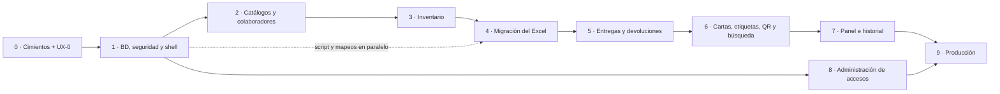

# Plan de desarrollo por etapas

> Estado: **borrador v0.2** (2026-10-19). Base: [01 — Diseño del sistema](01-diseno-del-sistema.md),
> [03 — Análisis y migración](03-analisis-y-migracion-de-datos.md) y [04 — Diseño UI/UX](04-diseno-ui-ux.md).
> Las pantallas se citan por su identificador del doc 04 (P-xx pantallas, D-xx diálogos).

## Forma de trabajo

- Cada etapa es **una rama y un PR** (`etapa-N-nombre`) que se despliega en un *deploy preview* de Netlify.
- **Regla del repositorio:** después del primer commit en `main`, todo cambio (etapas, correcciones,
  documentos) va en una rama nueva con su PR. **El merge solo lo aprueba y lo hace el usuario**; nunca hay push
  directo a `main` ni auto-merge.
- Una etapa se cierra cuando cumple sus **criterios de aceptación** y la validas en el preview. Hasta entonces
  no empieza la siguiente (salvo las marcadas como paralelas).
- El esquema de base de datos se cambia solo con **migraciones SQL versionadas**; nunca editando a mano en el
  panel de Supabase.
- Hasta la salida a producción (Etapa 9), `main` se despliega contra el proyecto Supabase **dev**.
- La interfaz se construye según el doc 04. **Al cerrar cada etapa con interfaz** se pasa una revisión de
  diseño con los skills de **Impeccable** (auditoría, crítica y pulido; ver §Herramientas de diseño) y se
  corrige lo que salga antes de pedir tu validación.
- Los documentos de `docs/` se actualizan cuando una etapa cambie una decisión.

**Definición de terminado (todas las etapas):** compila sin errores ni advertencias de lint; pruebas de la
etapa en verde; funciona en móvil y escritorio; accesible con teclado; los permisos se probaron con un
usuario Lector; revisión de diseño hecha (si hubo interfaz); documentación actualizada.

Tamaños relativos: **S** pequeño · **M** mediano · **L** grande.

## Herramientas de diseño

| Herramienta | Uso en el proyecto |
|---|---|
| **Impeccable** v4.6.0 (Apache-2.0). **Instalado** el 2026-10-19 en `.claude/skills/impeccable` | Revisión y dirección de diseño. En la Etapa 0, `/impeccable init` crea `PRODUCT.md` con el contexto del producto; cuando haya código, `/impeccable document` crea `DESIGN.md`. Al cerrar cada etapa con interfaz se corren `audit` (accesibilidad, rendimiento, adaptable), `critique` (jerarquía y claridad) y `polish` (pase final); según el caso, también `harden` (errores y casos límite), `clarify` (textos), `adapt` (móvil) o `typeset`/`layout`. La app es de modo **Operate** (herramienta de trabajo): precisión y sobriedad antes que efectos. Se instaló **sin sus hooks automáticos**, que correrían su detector después de cada edición; se pueden activar después con `/impeccable hooks on` |
| **UI UX Pro Max** (MIT). **Instalado** el 2026-10-19 en `.claude/skills/ui-ux-pro-max` | Como consulta, no como dirección: sus reglas para React + Tailwind + shadcn/ui, sus guías de UX y su guía de tipos de gráfica. **No** se usa su generador de sistemas de diseño, porque la identidad ya la define la marca |
| **motion-design-skill** de LottieFiles (MIT). **Instalado** el 2026-10-19 en `.claude/skills/motion-design` | Criterios de movimiento sobrios: duraciones y curvas, retroalimentación de estados (cargando → éxito/error al registrar una entrega) y «reducir movimiento». Solo microinteracciones, en línea con el doc 04 §7.4 |
| Skill **dataviz** (ya disponible) | Gráficas y tarjetas de cifras del panel (Etapa 7) |
| **Figma** (conector disponible, opcional) | Prototipo navegable de P-10, P-12, P-21 y P-23 en la fase UX-0, si quieres probar el flujo antes de construirlo |

Si dos skills se contradicen, manda el doc 04: la marca y las decisiones que tomaste.

## Mapa de etapas

La Etapa 8 puede hacerse en cualquier momento tras la 1. El script de migración y la revisión de mapeos
(Etapa 4) pueden avanzar en paralelo a las Etapas 2–3; la **carga** sí requiere que el inventario exista.

---

## Etapa 0 — Cimientos del proyecto y validación de UX · S

**Objetivo:** repositorio, herramientas y despliegue funcionando de punta a punta, y el diseño de interfaz
validado, antes de escribir lógica.

Proyecto:
- Repositorio git + GitHub (cuenta `ErikAboytes`, ya conectada); `.gitignore` que excluye `*.xlsx`, `*.pdf`
  de cartas reales, `.env*` y `scripts/migracion/salida/`.
- Proyecto Vite + React + TypeScript; ESLint, Prettier, Tailwind, alias de rutas, estructura de carpetas (§9 del diseño).
- Supabase CLI inicializado y enlazado al proyecto **«Tersa»** como entorno **dev** (ya existe). Producción se
  crea en la Etapa 9.
- Sitio Netlify conectado a GitHub: `netlify.toml`, `public/_redirects`, variables de entorno, deploy previews.
  **Hecho (2026-10-19):** sitio **`tersa-it-dev`** (`https://tersa-it-dev.netlify.app`), creado por el usuario y
  conectado al repositorio. Despliega `main` y genera deploy previews de los PRs, con las variables
  `VITE_SUPABASE_URL`, `VITE_SUPABASE_PUBLISHABLE_KEY` y `SECRETS_SCAN_OMIT_KEYS`. Los sitios
  `inventarios-web` e `inventarios-dev` (intento anterior) e `inventario-ti-tersa` (creado y sin usar) no se tocan.
- README: cómo instalar, correr y desplegar.

Diseño (fase UX-0 del doc 04):
- **Impeccable** ya está instalado. Se corre `/impeccable init` para que genere `PRODUCT.md` a partir de los
  docs 01 y 04. La primera vez descarga su motor (≈ 19 MB desde las releases oficiales, verificado con
  SHA-256); te aviso antes de ejecutarlo.
- Validar contigo el doc 04 (navegación, pantallas, flujos, bocetos).
- Identidad visual de **Grupo Tersa** (doc 04 §7: minimalista, moderna y empresarial; paleta medida del
  logotipo y con contraste verificado) convertida en tokens de Tailwind; página de muestra con botones,
  badges de estado, campos y barra superior.
- Opcional: prototipo en Figma del flujo de entrega.

**Aceptación:** `npm run build` limpio · la URL de Netlify abre · recargar `/cualquier/ruta` no da 404 ·
un PR genera su deploy preview · doc 04 aprobado · tokens con contraste AA.

**Necesito de ti:**
- Confirmar con quien administre los formatos si la carta con el nuevo logotipo pasa a `F.TI-006-03`.
- Si existen, versiones oficiales del logotipo de Grupo Tersa en SVG (completo, sin lema e isotipo). Ya está
  en el proyecto el que me pasaste (`docs/assets/marca/`).

## Etapa 1 — Base de datos, seguridad y shell de la app · M

**Objetivo:** el esquema completo y las reglas de acceso, más el «esqueleto» navegable de la app.

Backend:
- La base «Tersa» parte vacía: la migración del diseño anterior ya se descartó el 2026-10-19. Por decisión
  tuya se conservan el event trigger `ensure_rls` (red de seguridad de RLS) y el usuario de Auth
  `test@test.com`. Las migraciones activan RLS de forma explícita en cada tabla de todos modos.
- Migraciones: extensiones (`pgcrypto`, `pg_trgm`, `unaccent`), enums, **todas** las tablas del diseño
  (incluidas `unidades_negocio` y `folios_control`), constraints (serie única, subcategoría solo en Otro,
  etiqueta de apartado, motivo de baja), índices.
- Triggers: marcas de tiempo/autor, auditoría a `movimientos`, guarda del estado `asignado`.
- `perfiles` (con puesto para la firma) + alta automática al crear usuario en Auth; helpers `es_admin()` /
  `es_usuario_activo()`.
- RLS en todas las tablas; `movimientos` solo inserción. Registro público desactivado.
- Pruebas SQL de permisos y constraints. Primer Administrador creado manualmente.

Frontend:
- Cliente Supabase, tipos generados, TanStack Query.
- `AppShell`, `Sidebar`, `TopBar`, menú móvil **D-06**; **P-01** login, **P-02** recuperar contraseña,
  **P-90** no encontrada, **P-91** sin permiso, marcador de **P-03**.
- Rutas protegidas con `?siguiente=` y guardas por rol; enlace «saltar al contenido»; títulos por ruta.

**Aceptación:** un Lector lee pero recibe error al escribir **vía API** · un usuario sin perfil activo no ve
datos · el menú móvil abre y cierra con Escape · recargar una ruta protegida conserva la sesión · tras
iniciar sesión se vuelve a la ruta pedida.

## Etapa 2 — Catálogos y colaboradores · M

**Objetivo:** los datos de referencia que el inventario necesita, y los componentes base que se reutilizarán.

- Componentes: `DataTable` (paginación del servidor, orden, tarjetas en móvil), `FilterBar` (filtros en la
  URL), campos, `Dialog`/`ConfirmDialog`, `Toast`, `StatusBadge`.
- **P-50** catálogos: empresas (razón social provisional = clave), contratos, ubicaciones, unidades de negocio,
  subcategorías de Otro.
- **P-40 / P-41** colaboradores: lista con búsqueda, alta, edición, baja lógica, ficha (sin equipos por ahora).

**Aceptación:** Admin crea/edita y ve errores claros ante duplicados · Lector no ve botones de edición y la
API le rechaza escrituras · filtros y página sobreviven a la recarga.

## Etapa 3 — Inventario de activos · L

**Objetivo:** el corazón del sistema: registrar y consultar equipos.

- **P-10** lista sobre `v_equipos`: búsqueda, filtros, orden (incluido **por empresa**), vista **agrupada por
  empresa**, paginación 25/50/100, selección múltiple.
- **D-05** exportación CSV del resultado filtrado completo (no solo la página), UTF-8 con BOM.
- **P-11 / P-13** alta y edición (número de producto, «sin serie visible», empresa desde el contrato).
- **P-12** ficha: datos, estado con su etiqueta, **estado físico** (condición + observaciones), historial del equipo.
- **Estado físico** en P-11/P-13 y filtro «Condición» en P-10. Ya están hechos y probados (rama
  `bd/mensajes-condicion-equipos`): la validación `exigirObservaciones` (`src/lib/condicion.ts`), los
  componentes `CamposEstadoFisico` y `EtiquetaCondicion`, y los mensajes del servidor con su campo
  (`mensajeDeError` / `campoDeError`). La Etapa 3 solo los conecta al formulario y a la ficha.
- **D-01** cambio de estado manual con «apartado para» y «motivo de desactivación».
- Búsqueda en la barra superior (solo equipos, por ahora).

**Aceptación:** no se puede repetir una serie (ni con distinto uso de mayúsculas/espacios) · Otro exige
subcategoría · Apartado exige etiqueta y Desactivado exige motivo · Con detalles/Dañado exige observaciones
(el mensaje dice qué escribir y aparece junto al campo, tanto si lo detecta el cliente como la BD) · `asignado` no se puede elegir a mano ·
el CSV abre en Excel con acentos correctos · cada edición aparece en el historial con «antes → después».

## Etapa 4 — Migración del Excel · M

**Objetivo:** cargar los **1,463 equipos** reales al entorno dev y validarlos con las pantallas ya hechas.

- `scripts/migracion/extraer.py` + archivos de mapeo (estados, ubicaciones, modelos, usuarios genéricos).
- Consolidado (1,449) + 14 equipos fuera de contrato; servidores/switches/UPS **no** se cargan.
- **Sesión de revisión contigo** de mapeos e incidencias (lista en §8 del doc 03).
- Carga a `staging` → transformación a tablas finales → reporte de conciliación.
- Asignaciones históricas con sus folios SIS/HIST; movimientos `importacion` con los datos originales.

**Aceptación:** 1,463 equipos · conteos por estado/categoría/empresa iguales al reporte (78 desactivados:
CGE, vendidas y donativos) · muestreo de 20 series correcto · ningún dato de LogMeIn en la base · todas las
incidencias resueltas o documentadas.

## Etapa 5 — Entregas y devoluciones · L

**Objetivo:** el flujo operativo diario con reglas garantizadas por la base de datos.

- Funciones `crear_asignacion`, `registrar_devolucion` (parcial/total, destino stock o mantenimiento, cierre
  por incidencia) y `actualizar_firmas`; folios **`CC-AA-NNNN`** y **`CD-AA-NNNN`** con `folios_control`.
- Apartados asignables solo con confirmación explícita.
- Pruebas SQL: equipo no asignable rechazado, doble asignación concurrente rechazada, transacción atómica,
  folios sin huecos.
- **P-21** asistente de entrega (con **D-04** datos de firma editables y **D-07** alta rápida de colaborador),
  **P-20** lista, **P-22** detalle, **P-24** vista imprimible, **P-25** devolución, **P-26** detalle de devolución.
- En **P-25**, cada renglón usa `CamposEstadoFisico` en modo devolución, prellenado con el estado físico del
  equipo. Los errores `asignacion_equipos_detalle_requiere_observaciones` se muestran en el renglón del equipo
  que los causó.
- Asignación actual en **P-12** y equipos actuales en **P-41**.

**Aceptación:** los equipos no asignables no aparecen y la API los rechaza · un Apartado no se entrega sin
la confirmación · si falla un equipo no se guarda nada · folios consecutivos sin huecos · devolver a
mantenimiento deja el estado y la ubicación correctos · la condición de la devolución actualiza el estado físico del equipo · recargar el asistente no pierde lo capturado.

## Etapa 6 — Cartas, etiquetas, QR y búsqueda · M-L

**Objetivo:** documentos imprimibles e identificación rápida de equipos.

- **Carta custodia** réplica del formato **F.TI-006-02** (1 equipo = formato actual; varios = tabla), firmas
  editables, nombre de archivo sugerido al guardar como PDF.
- **P-23** documentos de la asignación: **carta + hoja de etiquetas generadas juntas** al completar la entrega.
- **Carta de devolución** bajo demanda desde **P-26**.
- **Etiquetas QR** en hoja carta (3 × 8 con guías de corte) por asignación y por lote (**P-70**); ruta **P-14** `/e/:id`.
- **P-31** búsqueda global (URL de QR, UUID, serie, colaborador sin importar acentos, folios CC/CD/SIS/HIST).
- **D-03** escáner con cámara: `BarcodeDetector` o respaldo zxing; mensajes claros sin soporte o sin permiso.

**Aceptación:** la carta coincide con F.TI-006-02 y cabe en hoja carta · las etiquetas impresas en papel
normal se leen con un celular · un QR escaneado sin sesión lleva al login y luego a la ficha · la búsqueda
encuentra «Chavez» cuando el dato es «Chávez» · en un navegador sin cámara se explica la alternativa.

## Etapa 7 — Panel operativo e historial global · M

**Objetivo:** visibilidad del estado del inventario.

- `metricas_panel()`: equipos activos, conteos por estado/categoría/empresa, contratos por vencer (90 días),
  movimientos recientes.
- **P-03** panel según el doc 04 §6 (datos útiles, profesional y minimalista): 4 cifras clave, «Requiere
  atención», distribución por empresa, avance de localización y actividad reciente (skill dataviz). Cada
  cifra abre el inventario ya filtrado. `metricas_panel()` calcula además el tiempo en el estado actual (a
  partir de `movimientos`), la serie semanal de «No localizado» y las asignaciones activas de colaboradores
  dados de baja.
- **P-30** historial filtrable con detalle de cambios y exportación.

**Aceptación:** cada cifra del panel coincide con su consulta de verificación · hacer clic en una cifra abre
la lista con el filtro equivalente.

## Etapa 8 — Administración de accesos · S-M

**Objetivo:** que un Administrador gestione usuarios sin entrar al panel de Supabase.

- Edge Function `admin-usuarios`: invitar, cambiar rol, desactivar/reactivar (verifica que quien llama es admin).
- **P-60** usuarios y **D-08** invitar/cambiar rol; correo de invitación en español; protección del último Administrador.

**Aceptación:** un Lector no puede invocar la función · un usuario desactivado pierde acceso en su siguiente
petición · no es posible quedarse sin Administradores.

## Etapa 9 — Endurecimiento y salida a producción · M

- Pruebas e2e (Playwright) de los flujos críticos sobre el preview.
- Auditoría final de accesibilidad y diseño adaptable (Impeccable + revisión manual con teclado y lector de pantalla).
- Pruebas con usuarios de las 4 tareas del doc 04 §13.
- *Advisors* de seguridad y rendimiento de Supabase; plan de respaldos; revisión del plan de Supabase.
- Producción: crear el proyecto prod con migraciones, SMTP para correos, dominio en Netlify.
- **Migración final** con el Excel congelado; capacitación breve y manual de usuario (`docs/`).
- Operación en paralelo con el Excel 1–2 semanas y retiro del Excel.

**Aceptación:** e2e en verde · sin alertas críticas en *advisors* · conciliación final aprobada · usuarios
capacitados.

---

## Riesgos

| Riesgo | Mitigación |
|---|---|
| Datos del Excel inconsistentes (ubicaciones, modelos, usuarios) | Mapeos revisables + reporte de incidencias antes de cargar |
| El Excel sigue cambiando durante el desarrollo | Carga repetible; carga final con archivo congelado |
| Proyecto gratuito de Supabase pausado o sin respaldos | Plan Pro o respaldo programado antes de producción |
| Credenciales expuestas en la columna LogMeIn | No migrarlas; cambiar esas contraseñas |
| Escaneo de QR no soportado en algunos navegadores | Respaldo zxing + búsqueda manual siempre disponible |
| Etiquetas en papel normal se desgastan | Recomendar cinta transparente encima o, más adelante, papel adhesivo con la misma rejilla |
| Reglas de negocio solo en el frontend | Reglas en SQL (constraints, RPC, RLS) con pruebas |
