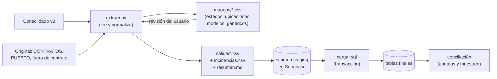

# Análisis del Excel actual y plan de migración

> Estado: **borrador v0.2** (2026-10-19). Cifras obtenidas al perfilar los archivos fuente. Incluye las
> decisiones D2, D8 y D9 del [diseño](01-diseno-del-sistema.md#12-decisiones).

## 1. Fuentes

| Archivo | Uso |
|---|---|
| `Inventario_consolidado_HP_TERSA_v2.xlsx` → hoja **Consolidado** | **Fuente principal** de equipos (1,449) |
| `INVENTARIO TERSA ACTUALIZADO 20-07-26.xlsx` → hoja **CONTRATOS** | Empresa, número de contrato, vencimiento y estatus de cada operación |
| `INVENTARIO TERSA ACTUALIZADO 20-07-26.xlsx` → hojas TERSA, RENAULT, CONTROL, REVOR, ROVAL | Columna **PUESTO** del colaborador (el consolidado la mezcló con Comentarios) |
| `INVENTARIO TERSA ACTUALIZADO 20-07-26.xlsx` → hoja **OTROS EQUIPOS SERIES NO ESTAN EN CONTRATO** | Equipos fuera de contrato (D9: se incluyen) |

El consolidado no trae empresa ni número de contrato, pero **todas sus operaciones (110) existen en la hoja
CONTRATOS** del archivo original, así que se recuperan cruzando por `Operación`.

**No se cargan** (D9): servidores, storage, switches, UPS y licencias. Ninguno está en el consolidado; solo
aparecen en la hoja TERSA del original.

> Los Excel y los CSV derivados contienen datos personales y credenciales: **no se suben al repositorio**
> (`.gitignore`) y se procesan solo en el equipo local.

## 2. Perfil de la hoja Consolidado

1,450 filas: **1,449 equipos** + 1 fila vacía. Columnas: Operación, Serie, Descripción, Tipo, Estatus,
Ubicación, Ciudad, Usuario, LogMeIn, C. Responsiva, Comentarios, Coincidencia Tersa.

| Columna | Hallazgo | Tratamiento |
|---|---|---|
| **Serie** | 1,449 valores, **sin duplicados**. 5 empiezan con `ICR` (probablemente `1CR`, prefijo de monitores HP). Algunos con espacios al inicio/fin | Clave natural; `trim` + mayúsculas; las 5 `ICR` van a revisión |
| **Tipo** | Laptop 579 · Desktop 437 · Monitor 424 · Otro 9 (iPads) | Mapeo directo a `categoria`; Otro → subcategoría «iPad/Tablet» |
| **Operación** | 110 códigos (`TERSA002`, `RENAULT015`, `CONTROL032`…) | → `contratos.operacion`; empresa y número de contrato desde CONTRATOS |
| **Empresa** (vía CONTRATOS) | TRO 802 · TAU 294 · CRVH 249 · REVOR 76 · ROVAL 28 | → `empresas`; razón social provisional = clave (D3) |
| **Descripción** | 125 textos distintos para los mismos modelos (`HP ProBook 440 G8` aparece de 5+ formas). 7 filas con `2F3X8LT` (parece número de parte) | Tabla de mapeo **descripción → marca, modelo**, revisada a mano; texto original se conserva en `descripcion` |
| **Estatus** | 10 valores, con errores de captura (`ASIGANADA`, `STOCK CABOS`) | Tabla de mapeo de estados (§3) |
| **Ubicación** | 186 valores distintos; «NO LOCALIZADO» usado como ubicación (455); 267 del tipo «STOCK SISTEMAS CAJA10/CAJON/MUEBLE»; 26 vacíos | Catálogo normalizado + `ubicacion_detalle` (§4) |
| **Ciudad** | 30 valores que mezclan ciudades y estados (TIJUANA, SINALOA, NAYARIT…); 496 vacíos | Se usa para completar `ciudad`/`estado_republica` de la ubicación |
| **Usuario** | 559 nombres (542 al normalizar mayúsculas y acentos). 57 valores genéricos en 152 equipos (SERVIDOR, VACANTE, ASESOR DE VENTAS, CONTABILIDAD…) | → `colaboradores` (§5) |
| **C. Responsiva** | 154 folios, todos con formato `SIS0001`–`SIS0755`; `SIS0044` cubre 2 equipos | Folio de la asignación histórica. Los nuevos usan `CC-AA-NNNN` (D4) |
| **Comentarios** | Mezcla de puestos («ASESOR DE VENTAS») y notas («Venta 03-09-26», «Detalle en teclado») | Los que describen daño físico («Detalle en teclado») van a `equipos.condicion = con_detalles` + `observaciones_estado`; el resto a `equipos.notas`. Sin comentario de daño, la condición queda «Sin revisar» (nulo). El puesto se toma del archivo original |
| **LogMeIn** | 45 valores; **16 contienen usuario y contraseña en texto plano** | **No se migra.** Recomendación: cambiar esas contraseñas |
| **Coincidencia Tersa** | Única 1,435 · Sin coincidencia 7 · Múltiple corregida 7 | No se migra; las 14 no únicas van a revisión |

Puesto: de 786 equipos con usuario, **660** tienen PUESTO recuperable del archivo original (cruce por serie;
1,445 de 1,450 series se encuentran ahí).

**Campos de la carta que el Excel no tiene:** *Número de producto* (solo existe en la hoja de fuera de
contrato) y *Unidad de Negocios*. Se cargan vacíos y se completan después; el asistente de entrega pide la
unidad de negocio si el colaborador no la tiene.

## 3. Mapeo de estados

| Estatus en Excel | Equipos | Estado nuevo | Notas |
|---|---|---|---|
| ASIGNADA, ASIGANADA | 566 | `asignado` | 548 con usuario → asignación histórica activa. **18 sin usuario → `pendiente`** con incidencia |
| NO LOCALIZADO | 503 | `no_localizado` | 153 tienen «último usuario» → se conserva en el historial. 2 dicen DONATIVO → revisión |
| STOCK, STOCK CABOS, STOCK SISTEMAS MUEBLE | 289 | `stock` | 37 con usuario anotado → historial |
| CGE | 63 | `desactivado` | **Vendidos a la compañía CGE** (D2). Motivo: «Vendido a CGE»; sin ubicación |
| VENDIDA | 12 | `desactivado` | Motivo: «Vendida» + comentario (p. ej. «Venta 03-09-26») |
| APARTADA | 5 | `apartado` | `apartado_para` desde usuario/comentario («Rossy Insunza», «Para venta»…) |
| (vacío) con DONATIVO | 3 | `desactivado` | Motivo: «Donativo 28-11-25» |
| (vacío) resto | 8 | `pendiente` | Incidencia para revisar |
| **Total consolidado** | **1,449** | | 78 quedan desactivados (CGE + vendidas + donativos) |

## 4. Normalización de ubicaciones

Reglas iniciales (el resultado se revisa en una tabla editable antes de cargar):

| Patrón | Ubicación normalizada | Detalle |
|---|---|---|
| `STOCK SISTEMAS CAJA10`, `… CAJON`, `… MUEBLE`, `… PRACTICANTE`, `… SITE` | Almacén Sistemas (tipo `almacen`) | `CAJA10`, `CAJON`, `SITE`… |
| `INV. CABOS RENAULT CAJA0020` | Almacén Renault Los Cabos | `CAJA0020` |
| `TERSA <sucursal>`, `RENAULT <ciudad>`, `CORPORATIVO VIA RAPIDA` | Sucursal/corporativo correspondiente | |
| `AGENCIA CGE…` | sin ubicación | los equipos están vendidos (`desactivado`) |
| `NO LOCALIZADO`, vacío, `DONATIVO …` | sin ubicación | el estado ya lo indica |

## 5. Colaboradores y asignaciones históricas

- Se crea un colaborador por nombre normalizado (mayúsculas, sin acentos ni espacios dobles), con puesto del
  archivo original y empresa de la operación del equipo. El riesgo de homónimos se revisa en el reporte.
- Valores genéricos (SERVIDOR, VACANTE, ASESOR DE VENTAS 2…) → colaborador tipo `generico` ligado a la
  sucursal (D8), para depurarlos después sin perder la información.
- **Equipos ASIGNADA con usuario** → asignación histórica **activa** (`es_historica = true`):
  - con C. Responsiva: una asignación por folio (SIS0044 queda con 2 equipos);
  - sin folio: una asignación por colaborador con folio `HIST-0001`, `HIST-0002`…
- **NO LOCALIZADO / STOCK / CGE con usuario:** no hay asignación activa. Si tienen folio SIS, se crea la
  asignación histórica **cerrada**; si no, el último usuario queda en la nota del movimiento de importación.
- Las asignaciones históricas no tienen datos de firma; si se reimprime su carta, se capturan en ese momento.
- Cada equipo recibe un movimiento `importacion` con los datos originales que no tienen columna propia
  (usuario, comentario, ciudad, coincidencia).

## 6. Equipos fuera de contrato (D9)

La hoja tiene **22 filas** (no 40: el rango del Excel incluye filas vacías), todas de **monitores**:

| Grupo | Filas | Tratamiento |
|---|---|---|
| Ya están en el consolidado (`CNC55306DM` ×2, `CNC5360G3N`, `CNC322142Y`, `CNC55306D4`, `CNC322142B`, `CNC322142H`, `CNC55306LT`) | 8 | Gana el registro del consolidado; el comentario de esta hoja (p. ej. «recolección Renault Hermosillo 05/04/26») se agrega a sus notas |
| **Nuevos** | **14** | Se cargan **sin contrato y sin empresa** (aparecen como «Sin empresa» hasta que se asigne una) |

De los 14 nuevos:

| Estado inicial | Equipos | Origen |
|---|---|---|
| `asignado` | 1 | LG 24MR400-B con usuario (Ma. Rosio Calderon, DFAC TJ Vía Rápida) → asignación histórica `HIST-…` |
| `stock` | 4 | HP LV2011, Acer, BenQ y Pixo en «STOCK SISTEMAS SITE / CAJA008» |
| `pendiente` | 9 | 8 HP LV1911 sin ubicación (uno con nota de recolección) y el HP 24V G5 «en resguardo Tersa Llantas San José del Cabo» |

Incidencias de esta hoja: el monitor **Pixo no tiene serie** (`N/A`) → se le asigna `SINSERIE-0001`; la serie
`CN3221427` tiene 9 caracteres y parece incompleta (las demás son `CNC322142x`) → revisión. La columna PROD.
llena `numero_producto` en los 3 que la tienen.

**Total a migrar: 1,449 + 14 = 1,463 equipos.**

## 7. Proceso

1. `scripts/migracion/extraer.py` lee los Excel (solo lectura), aplica los mapeos y genera CSV limpios,
   `incidencias.csv` (cada fila que requiere decisión humana, con motivo) y `resumen.md` (conteos).
2. Los archivos `mapeos/*.csv` se pueden abrir en Excel; se revisan contigo y se vuelve a ejecutar.
3. Los CSV se cargan a un esquema `staging` y `cargar.sql` los transforma a las tablas finales en una sola
   transacción. En desarrollo se puede repetir desde cero las veces necesarias.
4. **Conciliación:** 1,463 equipos; conteos por estado, categoría y empresa iguales a las tablas de §3 y §6;
   muestreo manual de 20 series contra el Excel; cero valores de LogMeIn en la base.
5. **Carga final a producción** (Etapa 9): con el Excel congelado en su última versión, mismo proceso.

## 8. Lista de incidencias a revisar contigo (Etapa 4)

- 5 series `ICR…` (¿`1CR…`?) y la serie `CN3221427`.
- 18 equipos ASIGNADA sin usuario.
- 2 equipos NO LOCALIZADO con comentario de DONATIVO.
- 8 equipos con estatus vacío sin otra pista.
- 14 filas con coincidencia Tersa no única.
- 7 filas con descripción `2F3X8LT`.
- 14 equipos fuera de contrato sin empresa.
- Posibles homónimos al unificar colaboradores.
