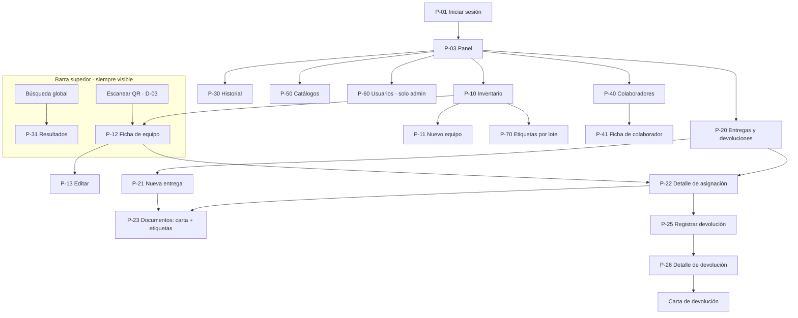

# Diseño de la interfaz (UI/UX) — arquitectura funcional

> Estado: **borrador v0.2** (2026-10-19). Interfaz para **Grupo Tersa**, con estilo minimalista, moderno y
> empresarial basado en su logotipo (§7). Complementa al [diseño del sistema](01-diseno-del-sistema.md)
> (datos, reglas y seguridad) y define **cómo se usa** el sistema: navegación, pantallas, flujos, componentes,
> comportamiento adaptable, accesibilidad e impresión. El [plan de desarrollo](02-plan-de-desarrollo.md)
> referencia las pantallas por su identificador (P-xx, D-xx).

---

## 1. Principios de experiencia

1. **Lo frecuente, a un paso.** Buscar o escanear un equipo y ver quién lo tiene se hace desde cualquier
   pantalla (búsqueda global en la barra superior). Entregar y devolver se hace en ≤ 3 clics desde el panel o la ficha.
2. **Prevenir antes que corregir.** El asistente de entrega solo ofrece equipos asignables; los campos
   condicionales (subcategoría, «apartado para», motivo de baja) aparecen solo cuando aplican.
3. **El estado siempre visible y en palabras.** Cada equipo muestra su estado con color **y** texto, más su
   etiqueta (apartado para / motivo de baja).
4. **Lo que ves es lo que se imprime.** Cartas y etiquetas tienen vista previa antes de imprimir y reproducen
   el formato oficial F.TI-006-02.
5. **Un solo patrón por tipo de pantalla.** Todas las listas, fichas y formularios se comportan igual en
   todos los módulos (mismos filtros, mismos botones en el mismo lugar).
6. **Cada rol ve lo que puede hacer.** El Lector no ve botones de edición (se ocultan, no se deshabilitan);
   la seguridad real está en la base de datos.
7. **Móvil para consultar y escanear; escritorio para capturar.** Todo funciona en ambos, pero el diseño
   móvil prioriza la ficha que abre el QR y el escáner.
8. **Sobrio y de marca.** Herramienta de trabajo de Grupo Tersa: neutra y ordenada, con la marca presente
   en el logotipo, el azul de las acciones y pequeños acentos amarillos (§7).

## 2. Usuarios y tareas

| Perfil | Contexto | Tareas principales |
|---|---|---|
| **Administrador** (Sistemas) | Escritorio en oficina; celular en sucursales y almacén | Entregar, devolver, dar de alta, cambiar estados, imprimir cartas y etiquetas, levantar inventario físico escaneando QR |
| **Lector: Contabilidad/finanzas** | Escritorio | Consultar inventario por empresa y contrato, exportar CSV, ver historial y cartas |
| **Lector: Dirección** | Escritorio | Ver el panel con las cifras generales |

Tareas por frecuencia (de mayor a menor) — guían el orden de la navegación y de los botones:

1. Buscar/escanear un equipo y ver a quién está asignado.
2. Registrar una entrega e imprimir carta + etiquetas.
3. Registrar una devolución.
4. Consultar/filtrar el inventario y exportarlo.
5. Dar de alta o editar un equipo; cambiar su estado.
6. Administrar colaboradores y catálogos.
7. Administrar usuarios.

## 3. Arquitectura de información



**Menú principal** (en este orden): Panel · Inventario · Entregas y devoluciones · Historial ·
Colaboradores · Catálogos ▸ (Empresas, Contratos, Ubicaciones, Unidades de negocio, Subcategorías) ·
Usuarios (solo Administrador).

**Barra superior:** logotipo · búsqueda global · botón «Escanear QR» · botón «Nueva entrega» (solo
Administrador) · menú de usuario (nombre, rol, cerrar sesión).

## 4. Layout y navegación

| Ancho | Navegación | Contenido |
|---|---|---|
| ≥ 1024 px (escritorio) | Barra lateral fija de 240 px, colapsable a iconos | Tablas completas, ficha a dos columnas |
| 768–1023 px (tableta) | Barra lateral colapsada a iconos con tooltip | Tablas con columnas secundarias ocultas |
| < 768 px (móvil) | Barra superior con botón de menú ☰ que abre un panel lateral (D-06) | Listas como tarjetas, ficha a una columna, barra de acciones fija abajo |

- **Menú móvil (D-06):** diálogo lateral; Escape lo cierra, el foco queda atrapado mientras está abierto y
  regresa al botón ☰ al cerrar; se cierra solo al elegir una opción.
- **Migas de pan** en fichas y formularios (`Inventario / 5CD626170N / Editar`).
- **Volver conserva el contexto:** los filtros, orden y página viven en la URL, así que regresar a la lista
  la deja como estaba.
- Enlace «Saltar al contenido» como primer elemento enfocable.

```text
ESCRITORIO
+-----------------------------------------------------------------------------------+
| [TERSA] Inventario TI   [ Buscar serie, colaborador, folio o QR...    ] [QR] [+ Entrega] (IG) v |
+--------------+--------------------------------------------------------------------+
| Panel        |  <contenido de la pantalla>                                        |
| Inventario   |                                                                    |
| Entregas     |                                                                    |
| Historial    |                                                                    |
| Colaborad.   |                                                                    |
| Catálogos  > |                                                                    |
| Usuarios     |                                                                    |
+--------------+--------------------------------------------------------------------+

MÓVIL
+------------------------------+
| [☰] TERSA          [🔍] [QR] |
+------------------------------+
|  <contenido>                 |
|                              |
+------------------------------+
| [ acción principal ]         |  <- solo en fichas, para Administrador
+------------------------------+
```

## 5. Inventario de pantallas

| ID | Ruta | Pantalla | Rol | Etapa |
|---|---|---|---|---|
| P-01 | `/login` | Iniciar sesión | público | 1 |
| P-02 | `/recuperar` | Recuperar contraseña | público | 1 |
| P-03 | `/` | Panel operativo | todos | 7 (marcador en 1) |
| P-10 | `/equipos` | Inventario (lista) | todos | 3 |
| P-11 | `/equipos/nuevo` | Nuevo equipo | admin | 3 |
| P-12 | `/equipos/:id` | Ficha de equipo | todos | 3 (+ asignación en 5, QR en 6) |
| P-13 | `/equipos/:id/editar` | Editar equipo | admin | 3 |
| P-14 | `/e/:id` | Destino del QR → abre P-12 | todos | 6 |
| P-20 | `/asignaciones` | Entregas y devoluciones (lista) | todos | 5 |
| P-21 | `/asignaciones/nueva` | Asistente de entrega | admin | 5 |
| P-22 | `/asignaciones/:id` | Detalle de asignación | todos | 5 |
| P-23 | `/asignaciones/:id/documentos` | Documentos: carta custodia + etiquetas | todos | 6 |
| P-24 | `/asignaciones/:id/imprimir` | Vista imprimible de la asignación | todos | 5 |
| P-25 | `/asignaciones/:id/devolucion` | Registrar devolución | admin | 5 |
| P-26 | `/devoluciones/:id` | Detalle de devolución (+ carta bajo demanda) | todos | 5 (carta en 6) |
| P-30 | `/historial` | Historial de movimientos | todos | 7 |
| P-31 | `/buscar` | Resultados de búsqueda global | todos | 6 |
| P-40 | `/colaboradores` | Colaboradores (lista) | todos | 2 |
| P-41 | `/colaboradores/:id` | Ficha de colaborador | todos | 2 (+ equipos en 5) |
| P-50 | `/catalogos/:catalogo` | Empresas, contratos, ubicaciones, unidades de negocio, subcategorías | todos (edita admin) | 2 |
| P-60 | `/admin/usuarios` | Usuarios y roles | admin | 8 |
| P-70 | `/etiquetas?ids=…` | Hoja de etiquetas por lote | todos | 6 |
| P-90 | `*` | Página no encontrada | todos | 1 |
| P-91 | — | Sin permiso | todos | 1 |

Diálogos:

| ID | Diálogo | Se abre desde |
|---|---|---|
| D-01 | Cambiar estado (con «apartado para» / motivo) | P-12, P-10 |
| D-02 | Confirmación de acción importante | varias |
| D-03 | Escáner QR con cámara | barra superior, P-21, P-31 |
| D-04 | Datos de firma y lugar (Entrega/Recibe) | P-21, P-23, P-26 |
| D-05 | Exportar CSV (progreso) | P-10, P-30, P-40 |
| D-06 | Menú móvil | barra superior (móvil) |
| D-07 | Alta rápida de colaborador | P-21 |
| D-08 | Invitar usuario / cambiar rol | P-60 |

Todos los diálogos cierran con **Escape** y con un botón visible, atrapan el foco y lo devuelven al
elemento que los abrió.

## 6. Pantallas clave

### P-01 · Inicio de sesión

Es la única pantalla con «momento de marca»: fondo `fondo`, logotipo completo de Grupo Tersa con su lema,
tarjeta blanca centrada con correo, contraseña, *Iniciar sesión* y *¿Olvidaste tu contraseña?*, y la franja
diagonal azul del logotipo como detalle al pie. Errores claros («Correo o contraseña incorrectos») sin revelar
si el correo existe. Si se llegó desde un QR, debajo del título se avisa: «Inicia sesión para ver el equipo».

```text
+--------------------------------------------------+
|                                                  |
|                 G R U P O                        |
|                 [ TERSA ]                        |
|           ¡Movilidad con pasión!                 |
|                                                  |
|        +------------------------------+          |
|        | Inventario de equipos de TI  |          |
|        | Correo     [...............] |          |
|        | Contraseña [...............] |          |
|        | [      Iniciar sesión      ] |          |
|        | ¿Olvidaste tu contraseña?    |          |
|        +------------------------------+          |
|                                                  |
|  ////////////////////////////////////            |  <- franja de marca
+--------------------------------------------------+
```

### P-10 · Inventario

- **Encabezado:** título, contador («1,463 equipos»), acciones: *Exportar CSV*, *+ Nuevo equipo* (admin).
  Con selección: *Imprimir etiquetas (N)*.
- **Filtros** (sincronizados con la URL): búsqueda de texto, Categoría, Estado (multiselección), Empresa,
  Contrato, Ubicación, Subcategoría, **Condición** (Sin revisar · Buen estado · Con detalles · Dañado; sirve
  para revisar los equipos migrados sin ese dato); *Limpiar filtros*; interruptor **Agrupar por empresa**.
- **Tabla:** casilla · Serie · Categoría · Marca/Modelo · Empresa · Operación · Ubicación · Estado (badge +
  etiqueta) · Asignado a. Orden al hacer clic en el encabezado (incluida Empresa). Clic en la fila → ficha.
- **Pie:** *Mostrar 25/50/100* · «1–25 de 1,463» · paginación.
- **Móvil:** cada equipo es una tarjeta (serie en negritas, modelo, badge, ubicación o colaborador).
- **Estados de la pantalla:** cargando (esqueleto), vacío («No hay equipos con estos filtros» + *Limpiar*),
  error (mensaje + *Reintentar*).

```text
Inventario                                          [Exportar CSV] [+ Nuevo equipo]
1,463 equipos
[Buscar en inventario.........] [Categoría v] [Estado v] [Empresa v] [Ubicación v]
[Contrato v] [Limpiar]                                   [ ] Agrupar por empresa
+---+------------+---------+-------------------+-------+------------+-------------+
|[ ]| Serie      |Categoría| Marca / Modelo    |Empresa| Estado     | Asignado a  |
+---+------------+---------+-------------------+-------+------------+-------------+
|[ ]| 5CD626170N | Laptop  | HP ProBook 440 G3 | REVOR | ● Asignado | J. C. López |
|[ ]| 1CR8190LT0 | Monitor | HP V244h          | CRVH  | ● No local.| —           |
|[ ]| 5CD2102F9Y | Laptop  | HP ProBook 440 G8 | TRO   | ● Apartado | Rossy I.    |
+---+------------+---------+-------------------+-------+------------+-------------+
Mostrar [25 v]                          1–25 de 1,463          [<] 1 2 3 … 59 [>]
```

### P-12 · Ficha de equipo (destino del QR)

Orden pensado para quien llega escaneando: **primero a quién está asignado**, luego los datos.

- **Encabezado:** icono de categoría, marca/modelo, serie, badge de estado con etiqueta. Acciones según
  estado y rol: *Entregar* (si es asignable), *Registrar devolución* (si está asignado), *Cambiar estado*
  (D-01), *Editar*, *Imprimir etiqueta*.
- **Asignación actual:** colaborador (enlace), puesto, unidad de negocio, ubicación, folio (enlace), fecha,
  *Ver carta*. Si no está asignado: «Sin asignación» + último colaborador conocido.
- **Datos:** número de producto, empresa, operación/contrato (con vencimiento), ubicación + detalle,
  descripción, **estado físico** (`EtiquetaCondicion` + observaciones debajo; «Sin revisar» si no tiene), notas.
  El admin lo cambia desde *Editar* (P-13), sin pasar por D-01: no es un cambio de estado del equipo.
- **QR:** vista previa + *Imprimir etiqueta*.
- **Historial:** línea de tiempo de movimientos con «campo: antes → después» (incluye «Estado físico: Buen
  estado → Con detalles» con sus observaciones).

```text
Inventario / 5CD626170N
+-------------------------------------------------------------------------------+
| [Laptop] HP ProBook 440 G3                 [Registrar devolución] [Editar] [⋯] |
| Serie 5CD626170N · REVOR · PEUGEOT006                       ● Asignado        |
+--------------------------------------------+----------------------------------+
| ASIGNACIÓN ACTUAL                          | DATOS                            |
| José Carlos López Medina                   | No. producto  W6B92LT#ABM        |
| Asesor de ventas camión · Llantas          | Contrato      PEUGEOT006         |
| Tersa Tecate                               | Empresa       REVOR              |
| Folio CC-26-0001 · 09/07/2026  [Ver carta] | Ubicación     Tersa Tecate       |
+--------------------------------------------+----------------------------------+
| HISTORIAL                                  | QR                               |
| 09/07/26 Entrega CC-26-0001 · I. González  |  [▣▣▣]  [Imprimir etiqueta]      |
|          Estado: Stock → Asignado          |                                  |
| 02/07/26 Edición · I. González             |                                  |
|          Ubicación: Caja 10 → Cajón        |                                  |
+--------------------------------------------+----------------------------------+
```

```text
MÓVIL (al escanear el QR)
+------------------------------+
| [☰] TERSA          [🔍] [QR] |
+------------------------------+
| HP ProBook 440 G3            |
| 5CD626170N       ● Asignado  |
| +--------------------------+ |
| | Asignado a               | |
| | José Carlos López Medina | |
| | Asesor de ventas camión  | |
| | Tersa Tecate             | |
| | CC-26-0001 · 09/07/2026  | |
| +--------------------------+ |
| Datos del equipo          v  |
| Historial                 v  |
+------------------------------+
| [ Registrar devolución ]     |
+------------------------------+
```

### P-11 / P-13 · Alta y edición de equipo

Secciones del formulario:

1. **Identificación:** Categoría (control segmentado: Desktop · Laptop · Monitor · Otro); Subcategoría
   (solo si Otro); Serie (+ casilla «No tiene serie visible»); Número de producto; Marca; Modelo
   (autocompletado con los existentes); Descripción.
2. **Propiedad:** Contrato/operación (selector con búsqueda; al elegirlo se llena la Empresa); Empresa
   (editable solo si no hay contrato).
3. **Ubicación:** Ubicación + detalle (caja, cajón, mueble).
4. **Estado** (solo en alta; en edición se usa D-01): Stock, Pendiente, Mantenimiento, Apartado, No
   localizado, Desactivado. Nunca «Asignado». Si es Apartado aparece «Apartado para»; si es Desactivado, «Motivo».
5. **Estado físico** (componente `CamposEstadoFisico`, en alta y en edición): Condición (control segmentado:
   Sin revisar · Buen estado · Con detalles · Dañado) y «Observaciones del estado» (área de texto, máx. 1,000
   caracteres). Solo se ve en el sistema; **no se imprime en las cartas**. Comportamiento:
   - Con Sin revisar o Buen estado las observaciones son opcionales; la ayuda dice «Opcionales. Solo se
     consultan en el sistema; no se imprimen en las cartas.»
   - Al elegir Con detalles o Dañado, el campo se marca obligatorio (\*) en ese momento y la ayuda cambia a
     «Obligatorias con «Con detalles» o «Dañado». Por ejemplo: «Ligero golpe en chasis y leves rayones en la
     pantalla. Sigue en estado funcional.»»
   - Si se guarda sin observaciones, el error aparece junto al campo con lo que hay que escribir según la
     condición (mensajes en §9) y el foco va al campo.
   - Volver a Sin revisar o Buen estado no borra lo escrito: las observaciones se conservan como nota del
     estado físico.
6. **Notas.**

Validación al salir de cada campo; al guardar, resumen de errores arriba con enlaces a cada campo. Aviso de
«cambios sin guardar» al intentar salir. La serie duplicada se informa con enlace al equipo existente.

### P-21 · Asistente de entrega

Cuatro pasos; el paso actual está en la URL (`?paso=2`) y el borrador se guarda en la sesión del navegador,
así que **recargar no pierde lo capturado**.

1. **Colaborador:** búsqueda por nombre o número de empleado; tarjeta con puesto, unidad de negocio,
   ubicación y equipos que ya tiene. *+ Nuevo colaborador* (D-07). Si le falta la unidad de negocio, se pide aquí.
2. **Equipos:** campo «Serie o escanear QR» + botón de escáner (D-03). Solo devuelve equipos asignables. Si se
   escanea uno no asignable se explica por qué («Asignado a X, folio CC-26-0012»). Los **Apartados** muestran
   su etiqueta y exigen marcar «Confirmo que se entrega a la persona/destino del apartado».
3. **Datos de carta:** fecha, lugar («Tijuana BC»), firma **Entrega** (nombre y puesto, prellenados con el
   usuario en sesión) y firma **Recibe** (prellenados con el colaborador). Todos editables. Observaciones.
4. **Confirmar:** resumen completo y botón *Registrar entrega*. Al terminar abre **P-23 Documentos**.

```text
Nueva entrega    (1) Colaborador ── (2) Equipos ── (3) Datos de carta ── (4) Confirmar
+-------------------------------------------------------------------------------+
| Colaborador: José Carlos López Medina · Tersa Tecate                [Cambiar] |
|                                                                               |
| Agregar equipo  [Serie o escanear QR.........................]  [Escanear]   |
|   Se pueden entregar equipos en Stock, Mantenimiento, No localizado,          |
|   Pendiente o Apartado.                                                       |
|                                                                               |
| Equipos a entregar (2)                                                        |
|  Laptop   HP ProBook 440 G8   5CD1244JFN   ● Stock                  [Quitar] |
|  Monitor  HP P24v G5          CNC322142B   ● Apartado para: J. C. López      |
|           [x] Confirmo que se entrega a la persona del apartado      [Quitar] |
|                                                                               |
|                                                    [Atrás]   [Continuar →]    |
+-------------------------------------------------------------------------------+
```

### P-23 · Documentos de la asignación

Se abre al registrar la entrega y desde el detalle de la asignación.

- Mensaje de éxito con el folio.
- Vista previa de la **carta custodia** y de la **hoja de etiquetas** (una por equipo entregado).
- Acciones: *Imprimir todo* (carta + etiquetas, con salto de página), *Imprimir carta*, *Imprimir etiquetas*,
  *Editar datos de firma* (D-04).

```text
✔ Entrega CC-26-0001 registrada
[Imprimir todo]  [Imprimir carta]  [Imprimir etiquetas (2)]  [Editar datos de firma]
+------------------------------+   +------------------------------+
| [TERSA]          Folio CC-.. |   | [▣] 5CD1244JFN | [▣] CNC3221 |
| Carta Custodia               |   |  HP ProBook 44 |  HP P24v G5 |
| Equipo de Cómputo            |   |  Laptop · TRO  |  Monitor ·  |
| ...                          |   +----------------+-------------+
+------------------------------+   +------------------------------+
```

### P-25 · Registrar devolución

- Lista de equipos activos de la asignación con casilla (devolución parcial o total).
- Por equipo: destino (**Stock** / **Mantenimiento**), condición (Buen estado / Con detalles / Dañado) y observaciones
  (obligatorias con Con detalles o Dañado). Vienen prellenadas con el estado físico actual del equipo y, al
  guardar, lo actualizan. Se usa el mismo `CamposEstadoFisico` en modo devolución: «Condición al devolver»
  sin la opción Sin revisar y «Observaciones de la devolución». El error queda en el renglón del equipo
  (con su serie) y el resumen de errores arriba enlaza a cada renglón incompleto.
- Opción separada **«Cierre por incidencia»** (extravío o baja) con destino No localizado / Desactivado y motivo obligatorio.
- Fecha y confirmación (D-02). Al terminar abre **P-26**, donde está el botón *Generar carta de devolución*
  (no se genera sola) y la edición de firmas (D-04).

### P-31 + D-03 · Búsqueda y escáner

- La búsqueda global acepta URL del QR, UUID, serie, nombre (sin importar acentos) o folio (`CC-`, `CD-`,
  `SIS`, `HIST-`). Atajo de teclado: **/** enfoca la búsqueda.
- Coincidencia exacta de QR/UUID/serie → abre la ficha directamente. Si no, P-31 agrupa resultados en
  Equipos · Colaboradores · Asignaciones.
- **D-03 Escáner**, cuatro estados:

| Estado | Qué se muestra |
|---|---|
| Sin soporte de cámara | «Tu navegador no permite escanear. Escribe la serie o el folio.» + campo de texto |
| Permiso negado | Cómo habilitar la cámara en el navegador + campo de texto |
| Escaneando | Vista de cámara con recuadro guía y texto «Apunta al código QR» |
| Leído | Cierra, apaga la cámara y abre la ficha |

  La cámara se apaga siempre al cerrar el diálogo (Escape incluido).

### P-03 · Panel operativo

**Requisito del usuario (2026-10-19):** el panel muestra **datos útiles para decidir**, de forma
**profesional y minimalista**. Cada elemento responde una pregunta concreta de quien lo mira; si no responde
ninguna, no va en el panel.

**Qué pregunta responde cada bloque** (en este orden, de arriba abajo):

| Bloque | Pregunta | Contenido |
|---|---|---|
| 1. Cifras clave (4, no más) | ¿Cómo está el inventario hoy? | **Equipos activos** (sin desactivados) · **Asignados** (% del activo) · **Disponibles para entregar** (Stock) · **No localizados** (con su tendencia contra el mes anterior: es la meta de éxito de `PRODUCT.md`) |
| 2. Requiere atención | ¿Qué tengo que resolver? | Lista corta con conteos y enlace: pendientes de revisar, en mantenimiento por más de 30 días, apartados por más de 15 días, contratos que vencen en 90 días, equipos asignados a colaboradores dados de baja. Si todo está en cero: «Nada pendiente» |
| 3. Distribución por empresa | ¿Dónde están los equipos de cada razón social? | Una barra horizontal apilada por empresa (TRO, TAU, CRVH, REVOR, ROVAL, Sin empresa) con los estados; el total al final de cada barra |
| 4. Avance de localización | ¿Estamos bajando los no localizados? | Línea simple por semana o mes de equipos «No localizado» desde la migración |
| 5. Actividad reciente | ¿Qué se movió? | Últimos 8 movimientos (entregas, devoluciones, cambios de estado) con fecha, equipo, colaborador y usuario; enlace a P-30 |

**Por rol:** el Administrador ve los cinco bloques y accesos rápidos (*Nueva entrega*, *Escanear QR*). Dirección
y Contabilidad ven los bloques 1, 3 y 4 arriba; «Requiere atención» queda abajo, solo para consulta.

**Reglas de presentación:**
- Cifras grandes en la tipografía de la app con números tabulares, etiqueta corta arriba y contexto abajo
  («62 % del activo», «−14 vs. septiembre»). Sin iconos decorativos dentro de las tarjetas.
- Gráficas sobrias según el skill **dataviz**: un solo tipo por pregunta, sin 3D, sin pasteles, sin leyendas
  que obliguen a buscar; los colores de estado del §7.3 y etiquetas directas sobre los datos.
- Todo es un enlace: cada cifra, segmento de barra o renglón abre el inventario o el historial con el filtro
  equivalente.
- Fecha y hora de cálculo visibles («Actualizado 19/10/2026 10:42»).
- Estados vacíos honestos: con pocos datos se dice («Aún no hay historial suficiente para la tendencia»), no se
  inventan gráficas.
- En móvil los bloques se apilan en el mismo orden; las barras se convierten en lista con totales.

```text
Panel                                                        Actualizado 19/10/2026 10:42
+----------------+  +----------------+  +----------------+  +----------------+
| Activos        |  | Asignados      |  | Disponibles    |  | No localizados |
| 1,385          |  | 566            |  | 289            |  | 503            |
| sin bajas      |  | 41 % del activo|  | en stock       |  | −14 vs. sep.   |
+----------------+  +----------------+  +----------------+  +----------------+
REQUIERE ATENCIÓN                         DISTRIBUCIÓN POR EMPRESA
26  Pendientes de revisar        →        TRO   ███████████▒▒▒▒░░  802
 4  En mantenimiento > 30 días   →        TAU   ████▒▒░            294
 3  Contratos vencen en 90 días  →        CRVH  ███▒▒░             249
                                          ...
AVANCE DE LOCALIZACIÓN                    ACTIVIDAD RECIENTE
503 ▔▔▔▔╲___  489                          19/10 Entrega CC-26-0001 · 5CD626170N · J. C. López
                                           ...                           Ver historial →
```

### P-30 · Historial

Filtros: rango de fechas, tipo de movimiento, equipo/serie, colaborador, usuario. Tabla: fecha · tipo ·
equipo · resumen («Estado: Stock → Asignado») · usuario · folio. Cada renglón se expande a la tabla de cambios
campo por campo. Exportable a CSV.

### P-41 · Ficha de colaborador

Datos, equipos que tiene ahora (con *Registrar devolución*), historial de asignaciones y devoluciones,
*Nueva entrega para este colaborador* (abre P-21 con el paso 1 resuelto).

## 7. Identidad visual — Grupo Tersa

**Dirección: minimalista, moderna y empresarial.** La interfaz es casi toda blanca y gris muy claro. El
**azul Tersa** identifica acciones y navegación; el **amarillo Tersa** aparece solo en detalles de marca. Lo
que lleva color es la información (estados, cifras); todo lo demás es neutro. Nada decorativo que no informe.

### 7.1 Logotipo

Archivo recibido: [`docs/assets/marca/logo-grupo-tersa.webp`](assets/marca/logo-grupo-tersa.webp) (500 × 270,
también en `.png`).

| Lugar | Versión |
|---|---|
| Inicio de sesión (P-01) | Logotipo completo con «GRUPO» y el lema «¡Movilidad con pasión!», ≈ 200 px de ancho |
| Barra superior | Logotipo **sin lema**, 32 px de alto (a ese tamaño el lema no se lee) |
| Favicon / icono de la app | Isotipo o la «T» sobre azul |
| Carta custodia y carta de devolución | Logotipo **completo de Grupo Tersa**, en lugar del de Tersa Corp. del formato anterior (decisión del usuario, 2026-10-19) |

Reglas: no deformarlo ni recolorearlo; dejar espacio libre alrededor; ponerlo sobre blanco o sobre el fondo
claro de la app (su contorno blanco también funciona sobre azul). **Pendiente:** versiones oficiales en SVG
(completo, sin lema e isotipo). Mientras tanto se recortan del archivo recibido.

### 7.2 Paleta

Colores medidos del logotipo. Los contrastes están calculados con la fórmula WCAG; todo el texto cumple AA (≥ 4.5:1).

| Token | Valor | Uso | Contraste |
|---|---|---|---|
| `marca-azul` | `#0055A3` | Botón primario, enlaces, elemento activo, anillo de foco | 7.4:1 sobre blanco; texto blanco encima 7.4:1 |
| `marca-azul-oscuro` | `#00478A` | Hover / presionado del primario | texto blanco encima 9.3:1 |
| `marca-azul-50` | `#E8F0F8` | Fila seleccionada, fondo del elemento activo del menú | azul encima 6.5:1 |
| `marca-amarillo` | `#FFF100` | **Solo acentos:** barra indicadora del menú activo, franja de marca. Nunca texto amarillo sobre blanco (1.2:1) | tinta encima 14.7:1; amarillo sobre azul 6.3:1 |
| `tinta` | `#0F1B2D` | Texto principal | 17.3:1 sobre blanco |
| `texto-secundario` | `#4A5568` | Etiquetas, ayudas, metadatos | 7.5:1 sobre blanco |
| `fondo` | `#F5F8FC` | Fondo de la app (blanco con tinte azul, como el sitio de Grupo Tersa) | |
| `superficie` | `#FFFFFF` | Tarjetas, tablas, diálogos | |
| `borde` | `#D9E0E8` | Divisores decorativos | |
| `borde-control` | `#7A8699` | Contorno de campos y casillas | 3.7:1 (mínimo para controles: 3:1) |

Los colores semánticos (éxito, aviso, error, información) reutilizan los tonos de Stock, Mantenimiento,
No localizado y Pendiente.

### 7.3 Colores de estado

Badge con fondo tenue, texto oscuro y punto de color, siempre con el nombre del estado. El mismo color en
toda la app.

| Estado | Texto | Fondo | Contraste |
|---|---|---|---|
| Stock | `#166534` | `#DCFCE7` | 6.5:1 |
| Asignado | `#0055A3` | `#E8F0F8` | 6.5:1 |
| Mantenimiento | `#92400E` | `#FEF3C7` | 6.4:1 |
| Apartado (+ «para …») | `#5B21B6` | `#EDE9FE` | 7.6:1 |
| Pendiente | `#155E75` | `#CFFAFE` | 6.5:1 |
| No localizado | `#991B1B` | `#FEE2E2` | 6.8:1 |
| Desactivado (+ motivo) | `#374151` | `#EEF0F3` | 9.0:1 |

«Asignado» usa el azul de marca en versión **tenue**, para no confundirse con los botones primarios, que son sólidos.

**Estado físico** (`EtiquetaCondicion`): reutiliza colores ya medidos, y el texto siempre dice la condición.

| Condición | Colores | Contraste |
|---|---|---|
| Sin revisar | los de Desactivado | 9.0:1 |
| Buen estado | los de Stock | 6.5:1 |
| Con detalles | los de Mantenimiento | 6.4:1 |
| Dañado | los de No localizado | 6.8:1 |

### 7.4 Tipografía, forma y espacio

- **Tipografía:** **Atkinson Hyperlegible Next** para la interfaz y **Atkinson Hyperlegible Mono** para
  series, folios, UUID y números de producto. Las dos son de Google Fonts (licencia OFL) y se incluyen en la app
  con `@fontsource`, sin depender de un CDN. El motivo es funcional: esta familia se diseñó para que no se
  confundan caracteres parecidos (`1`/`I`/`l`, `0`/`O`), y el inventario vive de leer series. El Excel actual
  ya tiene ese error: 5 series capturadas como `ICR…` en lugar de `1CR…`. Pesos 400/500/600; sin cursivas (la
  cursiva es exclusiva del logotipo). Escala: 12 metadatos · 14 tablas · 16 cuerpo · 20 títulos de sección · 24
  título de página · 30 cifras del panel. Números tabulares en tablas.
- **Forma:** radio de 8 px en controles y 12 px en tarjetas; bordes de 1 px en lugar de sombras (sombra suave
  solo en diálogos y menús flotantes).
- **Espacio:** escala de 4 px; filas de tabla de 44 px; contenido con ancho máximo de 1440 px; espacio en
  blanco generoso entre secciones.
- **Iconos:** Lucide, trazo de 1.5 px, 20 px; en la navegación siempre acompañados de texto.
- **Motivo de marca:** las franjas diagonales del logotipo, con moderación: solo en la pantalla de inicio de
  sesión y en los estados vacíos. En el menú, el elemento activo lleva una barra amarilla de 3 px a la
  izquierda sobre fondo `marca-azul-50`.
- **Movimiento:** transiciones de 150–200 ms solo en hover y al abrir diálogos y menús; se desactivan con
  «reducir movimiento».
- **Se evita:** degradados, sombras marcadas, fondos amarillos grandes, mayúsculas sostenidas (salvo siglas) y
  más de un botón primario por pantalla.
- Modo oscuro: fuera de la v1.

```text
BARRA SUPERIOR Y MENÚ (escritorio)
+--------------------------------------------------------------------------------+
| [GRUPO TERSA]   [ Buscar serie, colaborador, folio o QR... ]  [QR] [+ Entrega] |  fondo blanco, borde inferior 1 px
+-------------------+------------------------------------------------------------+
| ▌Panel            |  <- activo: barra amarilla 3 px + fondo azul-50 + texto azul
|  Inventario       |  <- inactivo: texto tinta, icono gris
|  Entregas         |
+-------------------+
```

## 8. Componentes

| Componente | Descripción |
|---|---|
| `AppShell`, `Sidebar`, `TopBar`, `MobileNav` | Estructura y navegación (§4) |
| `GlobalSearch`, `ScannerDialog` | Búsqueda en barra superior y escáner (D-03) |
| `PageHeader` | Título, migas de pan, acciones de la pantalla |
| `DataTable` | Orden, selección, paginación del servidor, vista de tarjetas en móvil, estados vacío/carga/error. `TablaDatos` acepta `grupo` para «Agrupar por empresa» (encabezado de grupo en tabla y tarjetas) |
| `FilterBar` | Filtros sincronizados con la URL, chips de filtros activos, «Limpiar». `FiltroMultiple` (casillas en un desplegable) para Estado; «Limpiar» conserva «Agrupar por empresa» |
| `StatusBadge` | Estado + etiqueta |
| `Field`, `Select`, `Combobox`, `SegmentedControl`, `DateField`, `Textarea` | Campos con etiqueta, ayuda y error asociados. Ya existen `CampoTexto`, `CampoArea`, `CampoSelect`, `CampoCasilla` y `ControlSegmentado` (radios nativos) |
| `CamposEstadoFisico`, `EtiquetaCondicion` | Sección «Estado físico» de P-11/P-13 y P-25, y su badge (ya existen, en `src/features/equipos/`) |
| `Stepper` | Pasos del asistente de entrega |
| `Dialog`, `ConfirmDialog` | Basados en Radix: Escape, foco atrapado, retorno de foco |
| `Toast` | Avisos con `aria-live` |
| `Timeline`, `DiffTable` | Historial y detalle de cambios |
| `KpiCard`, `BarChart` | Panel |
| `PrintLayout`, `CartaCustodia`, `CartaDevolucion`, `HojaEtiquetas`, `QRCode` | Documentos imprimibles |
| `RoleGate` | Muestra u oculta según el rol |

## 9. Patrones de interacción

- **Retroalimentación:** aviso breve al guardar; los errores de validación van junto al campo. Los cambios
  de estado esperan la respuesta del servidor (las reglas viven en la BD), con el botón en «Guardando…» y
  deshabilitado para evitar dobles envíos.
- **Errores del servidor en lenguaje humano:** cada restricción de la BD tiene su mensaje
  («Ya existe un equipo con la serie 5CD626170N — ver equipo»).
- **Regla del estado físico** (Con detalles o Dañado exigen observaciones). El cliente valida antes de
  enviar con el mismo criterio que el CHECK de la BD; si aun así el servidor la rechaza, `campoDeError`
  lleva el mensaje al campo correspondiente en lugar de dejarlo arriba del formulario.

  | Dónde | Cuándo | Mensaje |
  |---|---|---|
  | Junto al campo | Con detalles sin observaciones | «Describe los detalles: qué tiene el equipo (golpes, rayones, piezas faltantes) y si sigue funcionando.» |
  | Junto al campo | Dañado sin observaciones | «Describe el daño: qué parte está dañada y si el equipo todavía funciona.» |
  | Servidor, equipo | `equipos_detalle_requiere_observaciones` | «Faltan las observaciones del estado físico: con «Con detalles» o «Dañado» hay que describir qué tiene el equipo.» |
  | Servidor, devolución | `asignacion_equipos_detalle_requiere_observaciones` | «Faltan las observaciones de la devolución: con «Con detalles» o «Dañado» hay que describir en qué condición regresa el equipo.» |

- **Confirmar solo lo importante:** registrar entrega/devolución, desactivar, cambiar rol. No se piden
  confirmaciones para acciones triviales o que se pueden deshacer.
- **Botones con verbos del negocio:** «Registrar entrega», «Registrar devolución», «Imprimir carta» (nunca «Aceptar»/«OK»).
- **Formatos:** fechas `dd/mm/aaaa`; miles con coma (1,463); folios y series en fuente tabular.
- **Teclado:** `/` busca · Escape cierra · Enter envía · flechas en listas desplegables.

## 10. Accesibilidad (objetivo WCAG 2.2 AA)

- Todo se opera con teclado; foco siempre visible; orden de tabulación lógico.
- Estructura con regiones (`header`, `nav`, `main`) y encabezados en orden; enlace «Saltar al contenido».
- Al cambiar de ruta: título de la pestaña actualizado y foco al encabezado principal (y anuncio para lectores de pantalla).
- Campos con `label`; ayuda y errores ligados con `aria-describedby`; resumen de errores enfocable.
- Contraste mínimo 4.5:1 en texto; la información nunca depende solo del color.
- Objetivos táctiles ≥ 44 px en móvil; funciona con zoom al 200 % sin scroll horizontal.
- Tablas con encabezados reales y `aria-sort`; paginación con nombres accesibles.
- Respeto de «reducir movimiento».
- Diálogos: Escape, foco atrapado, `aria-modal`, foco devuelto al cerrar.

## 11. Impresión

| Documento | Reglas |
|---|---|
| **Carta custodia** | Hoja carta, márgenes de la plantilla actual; se ocultan menús y botones; tablas sin cortes entre páginas; el título de la página = nombre de archivo sugerido al guardar como PDF (`F.TI-006-02 Carta Custodia CC-26-0001 <serie> <nombre>`) |
| **Carta de devolución** | Mismo estilo, folio `CD-…` |
| **Etiquetas** | Hoja carta normal, rejilla de 3 × 8 (≈ 6.5 × 3.2 cm) con guías de corte; QR ≥ 2.5 cm; medidas en mm para que no cambien con el zoom |
| **Vista imprimible de asignación** | Resumen sin texto legal ni firmas |

Todos los impresos deben verse bien en **blanco y negro**: el QR siempre negro sobre blanco y los estados
escritos con palabras. Las cartas llevan el logotipo de Grupo Tersa; las etiquetas llevan el texto
«GRUPO TERSA · Sistemas» en lugar del logotipo, para que se lea en impresora de oficina.

```text
ETIQUETA (≈ 6.5 × 3.2 cm)
+--------------------------------------+
| [▣▣▣▣]  5CD626170N                   |
| [▣▣▣▣]  HP ProBook 440 G3            |
| [▣▣▣▣]  Laptop · REVOR               |
|         PEUGEOT006                   |
+--------------------------------------+
```

## 12. Rutas y estado en la URL

- Todas las rutas son recargables y enlazables (Netlify `_redirects`: `/*  /index.html  200`).
- **Filtros en la URL** con nombres en español: `q`, `categoria`, `estado` (varios separados por coma),
  `empresa`, `contrato`, `ubicacion`, `subcategoria`, `orden` (`empresa:asc`), `agrupar=empresa`, `pagina`,
  `por_pagina`. Ejemplo: `/equipos?estado=stock,pendiente&empresa=TRO&orden=serie:asc&pagina=2`.
- **Sin sesión:** cualquier ruta protegida lleva a `/login?siguiente=<ruta>` y, tras entrar, regresa ahí.
  Así, escanear un QR sin sesión termina en la ficha correcta después del login.
- Rutas de solo Administrador muestran P-91 a un Lector (y la API rechaza igualmente la operación).

## 13. Plan de diseño e implementación de la interfaz

**Fase UX-0 (junto con la Etapa 0) — validar antes de programar pantallas:**

1. Revisar contigo este documento: mapa de navegación, inventario de pantallas, flujos y bocetos.
2. Validar la identidad visual del §7 (paleta ya medida del logotipo y con contraste verificado) y pasarla a
   tokens de Tailwind; página de muestra con botones, badges de estado, campos y la barra superior.
3. Opcional: prototipo navegable de las pantallas P-10, P-12, P-21 y P-23 (por ejemplo en Figma) para probar
   el flujo de entrega antes de construirlo.

**Construcción por etapa** (se detalla en el [plan](02-plan-de-desarrollo.md)):

| Etapa | Interfaz que se construye |
|---|---|
| 1 | `AppShell`, `Sidebar`, `TopBar`, `MobileNav` (D-06), P-01, P-02, P-90, P-91, marcador de P-03 |
| 2 | `DataTable`, `FilterBar`, campos, `Dialog`/`ConfirmDialog`, `Toast`, `StatusBadge`; P-40, P-41, P-50 |
| 3 | P-10, P-11, P-12 (sin asignación), P-13, D-01, D-05; búsqueda en barra superior (solo equipos). Usa `CamposEstadoFisico` y `EtiquetaCondicion`, ya hechos |
| 4 | Sin pantallas nuevas: se revisan P-10 y P-12 con los datos reales migrados |
| 5 | `Stepper`; P-20, P-21, P-22, P-24, P-25, P-26, D-04, D-07; asignación en P-12 y equipos en P-41 |
| 6 | Documentos imprimibles, P-23, P-70, P-14, P-31, D-03; búsqueda global completa |
| 7 | P-03 completo, P-30, `Timeline`, `DiffTable`, `KpiCard`, gráficas |
| 8 | P-60, D-08 |
| 9 | Auditoría de accesibilidad, pruebas con usuarios y pulido |

**Validación con usuarios** (al cerrar las Etapas 3, 5 y 6, con 1–2 personas de Sistemas):

1. «Encuentra la laptop 5CD626170N y dime quién la tiene.» (con búsqueda y con QR en el celular)
2. «Entrega una laptop y un monitor a un colaborador e imprime la carta y las etiquetas.»
3. «Registra que el monitor regresó a mantenimiento.»
4. «Exporta los equipos en stock de la empresa TRO.»

Se registra el tiempo, los errores y las dudas de cada tarea; lo que salga se corrige antes de la siguiente etapa.
